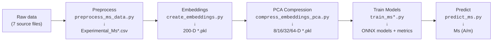

# compound-to-experimental-ms

Predict the **experimental saturation magnetisation Ms** (in A/m) of a magnetic compound
directly from its chemical formula, via a matscholar200 compound embedding.

This is a sibling of `compound-to-experimental-tc` (same pipeline and code structure) but
targets Ms instead of Tc, and is fed by the raw Ms sources used by `my_ms`. The companion
project `compound-to-simulated-ms` is identical but targets the *simulated* (DFT) Ms.

> **Trained in log-space.** Ms spans ~6 orders of magnitude, so models are trained on
> `log1p(Ms)`; `predict_ms.py` applies `expm1` so predictions come back in physical A/m.

> **What the target actually is (important).** The source databases report the *collinear /
> fully-aligned* magnetic moment per cell. For **ferromagnets** this equals the physical
> saturation magnetisation, so metals/intermetallics predict well (~±10–20%). For
> **ferrimagnets** (spinel ferrites, garnets like YIG, magnetite Fe₃O₄) it is the
> *uncompensated* moment — the antiparallel sublattices are **not** cancelled — so the
> training Ms, and hence the model, is several-fold **larger** than the true net Ms
> (e.g. Fe₃O₄ training ≈ 1.6×10⁶ vs physical ≈ 4.8×10⁵ A/m). Read predictions for
> ferrimagnetic oxides as the collinear moment, not the net saturation magnetisation.
> (Deduplication uses the pymatgen *reduced formula*, so spellings like CoFe₂O₄ / Fe₂CoO₄
> are pooled.) See `first_model_analysis.txt` and `further_improvements.txt`.
>
> **You can verify this yourself.** `data/validation_ferrimagnetic_compounds_reference.csv` lists 13 known
> ferrimagnets with their *measured net* Ms. Run
> `python src/validate_reference_data.py --ref data/validation_ferrimagnetic_compounds_reference.csv`
> and you will see the model over-predict every one — median ≈ +360 %, e.g. Fe₃O₄ +259 %,
> YIG +503 %, up to +9700 % for Gd₃Fe₅O₁₂ (near its compensation point) — confirming that
> the learned quantity is the collinear moment, not the net Ms.

## Pipeline overview

```
data/<raw sources>                         (per-project copies of the 7 raw files)
  └─ src/preprocess_ms_data.py   ──► preprocessed_data/Experimental_Ms{,_all,_RE,_RE-Free}.csv
       └─ src/create_embeddings.py        ──► outputs/*_w_embeddings.pkl        (200-D)
            └─ src/compress_embeddings_pca.py ──► outputs/*_w_embeddings_PCA.pkl (+PCA 8/16/32/64)
                 └─ src/train_ms.py (+ _all/_re/_re_free) ──► results/onnx_models/*.onnx,
                                                              results/exp_ms_best_by_dataset.csv
                      └─ src/predict_ms.py   ──► Ms (A/m) for any formula
```



## 0. Installation

Python ≥ 3.12. Create a venv and install `requirements.txt`:
```bash
python3 -m venv .venv && source .venv/bin/activate
pip install -r requirements.txt
```
(The SLURM scripts `source .venv/bin/activate`; adjust if your environment differs.)

## 1. Pre-process the raw data

`src/preprocess_ms_data.py` reads the raw **experimental** Ms sources from `data/`, converts
each to A/m, pools all values per composition into a **single median** (no mean, no
median-of-medians), flags rare-earth membership (pymatgen), drops unparsable formulae,
**drops low-Ms compounds** (`--ms-threshold`, default 50000 A/m, as in `my_ms`), and by
default **drops known ferrimagnets** (see below).

```bash
python src/preprocess_ms_data.py                    # default: drop known ferrimagnets, --ms-threshold 50000
python src/preprocess_ms_data.py --include-ferrimagnets   # keep known ferrimagnets
python src/preprocess_ms_data.py --ms-threshold 0   # keep all Ms magnitudes
```

**`--include-ferrimagnets`** (default: off → ferrimagnets dropped). For ferrimagnets the
training Ms is the *collinear / uncompensated* moment, not the net saturation magnetisation
(see the "What the target actually is" note above), so by default the script removes the
compounds it can confidently identify as ferrimagnetic — magnetite (Fe₃O₄), classic spinel
ferrites (MFe₂O₄), iron garnets (R₃Fe₅O₁₂) and hexaferrites (MFe₁₂O₁₉) — a **curated,
high-confidence subset** (~18, to be extended). The script prints a warning either way:
- default → `CAREFUL: the dataset MAY STILL CONTAIN UNKNOWN ferrimagnets` (composition cannot
  identify ferrimagnetism in general);
- with the flag → `CAREFUL: N KNOWN ferrimagnets ARE INCLUDED`.

Raw sources (in `data/`) and their conversion to A/m:

| source | sep | composition col | value col | → A/m |
|---|---|---|---|---|
| `literature_values.csv` | `;` | `Compound` | `mu0Ms (T)` | `/ µ0` |
| `Bhandari_I_exp.csv` | `\|` | `Material` | `Ms_exp (MA/m)` | `× 1e6` |
| `Bhandari_XIII_exp.csv` | `\|` | `Material` | `Ms (MA/m)` | `× 1e6` |
| `mp_fm_dedup_exp_data.csv` | `,` | `formula_pretty` | `total_magnetization_normalized_vol` | `× µ_B/ų` |

Outputs (`preprocessed_data/`): `Experimental_Ms.csv` (composition, Ms, contains_re),
`Experimental_Ms_all.csv`, `Experimental_Ms_RE.csv`, `Experimental_Ms_RE-Free.csv`.

## 2–3. Embeddings + PCA

```bash
python src/create_embeddings.py        # → outputs/*_w_embeddings.pkl (200-D matscholar200)
python src/compress_embeddings_pca.py  # → adds comp_emb_pca_8/16/32/64
```

## 4. Train

**NEEDS** (from steps 1–3): the preprocessed CSVs (`preprocessed_data/*.csv`) and the PCA
embeddings (`outputs/*_w_embeddings_PCA.pkl`). Run steps 1–3 first.

```bash
python src/train_ms.py            # all three datasets (RE-Free, RE, All)
# or one at a time (SLURM-friendly):
python src/train_ms_all.py
python src/train_ms_re.py
python src/train_ms_re_free.py
```

Which model families run is set in **`training_config.yaml`** (currently **LightGBM + RF**,
`re_features: true`). Training is in `log1p(Ms)` space; metrics/plots are reported in log1p
units. Outputs: `results/onnx_models/<Dataset>_<emb>_<model>[_refeats]_e<N>.onnx`,
per-dataset `*_results[_agg].csv`, and `results/exp_ms_best_by_dataset.csv`.

### Configuration (`training_config.yaml`)
- `re_features: true` — append 7 rare-earth physics features → 207-D input; ONNX gets a
  `_refeats` suffix (raw_200D only). `predict_ms` computes & appends them automatically.
- `models:` — per-family `enabled` / `ensemble`. Only the best + 2nd-best families
  (LightGBM, Random Forest) are enabled; Linear and MLP are disabled (far behind on Ms).

## 5. Predict

`src/predict_ms.py` predicts Ms (A/m) for any formula using the exported ONNX models — it
does all preprocessing internally (embedding, PCA/scaler baked into the graph, RE features,
and `expm1` back to A/m).

**NEEDS**: the ONNX models from step 4 (`results/onnx_models/*.onnx`) — run training first;
`python src/predict_ms.py --list` shows what's available.

```bash
python src/predict_ms.py --compound Nd2Fe14B --best      # best model for the compound type
python src/predict_ms.py --compound Fe --all             # all applicable models, mean ± std
python src/predict_ms.py --compounds-file new_materials.txt --best
python src/predict_ms.py --list
python src/predict_ms.py --compound Fe --best --no-disclaimer   # suppress the disclaimer
```

> **Are these compounds actually new?** `python -m src.check_new_materials` cross-checks every
> formula in `new_materials.txt` against the raw sources, the training set, and the validation
> references (matched by reduced formula) and writes `new_materials_known.txt`. For the shipped
> list all 8 are already present in the data — so predicting them is in-sample, not a
> generalisation test.

**Reliability disclaimer.** By default `predict_ms.py` prints a disclaimer to **stderr**
before predicting (except for `--list`), warning that the learned target is the DFT
collinear moment — correct for ferromagnets but an over-estimate for ferri-/antiferromagnets
(ferrites, garnets, oxides), so predictions must be checked and used with care. It goes to
stderr, so it never pollutes the machine-readable table on stdout. Pass **`--no-disclaimer`**
to suppress it (e.g. for scripted/batch use).

`--best`/`--all` auto-detect rare-earth content and pick the right dataset's model(s). The
RE and RE-Free models do not extrapolate across the RE boundary, so `predict_ms` **refuses**
a mismatched `--model` (use an `All_*` model, which is valid for both).

## 6. Results

All models trained with the default option where known ferrimagnets are dropped and ms-threshold is 50000 (A/m).

### Best model per dataset

| Dataset | Embedding | Model | N  | R² (mean ± std) | MAE (mean ± std) | RMSE (mean ± std) | MAE_Am    | MedRelErr |
| ------- | --------- | ----- | -- | --------------- | ---------------- | ----------------- | --------- | --------- |
| RE      | raw_200D  | LGBM  | 10 | 0.891 ± 0.008   | 0.215 ± 0.006    | 0.323 ± 0.010     | 66465.866 | 0.132     |
| All     | raw_200D  | LGBM  | 10 | 0.805 ± 0.010   | 0.279 ± 0.004    | 0.389 ± 0.009     | 71940.701 | 0.192     |
| RE-Free | raw_200D  | LGBM  | 10 | 0.744 ± 0.012   | 0.303 ± 0.007    | 0.408 ± 0.010     | 72449.077 | 0.219     |

### Results All-Materials

| Dataset | Embedding | Model | N  | R² (mean ± std) | MAE (mean ± std) | RMSE (mean ± std) | MAE_Am     | MedRelErr |
| ------- | --------- | ----- | -- | --------------- | ---------------- | ----------------- | ---------- | --------- |
| All     | raw_200D  | LGBM  | 10 | 0.805 ± 0.010   | 0.279 ± 0.004    | 0.389 ± 0.009     | 71940.701  | 0.192     |
| All     | pca_32    | LGBM  | 10 | 0.785 ± 0.009   | 0.298 ± 0.004    | 0.409 ± 0.009     | 77305.793  | 0.209     |
| All     | pca_64    | LGBM  | 10 | 0.780 ± 0.009   | 0.304 ± 0.005    | 0.414 ± 0.008     | 78748.993  | 0.217     |
| All     | pca_16    | LGBM  | 10 | 0.765 ± 0.008   | 0.315 ± 0.006    | 0.428 ± 0.008     | 83101.114  | 0.226     |
| All     | raw_200D  | RF    | 10 | 0.764 ± 0.009   | 0.320 ± 0.005    | 0.429 ± 0.005     | 84403.268  | 0.232     |
| All     | pca_32    | RF    | 10 | 0.747 ± 0.008   | 0.338 ± 0.004    | 0.444 ± 0.006     | 91170.704  | 0.254     |
| All     | pca_16    | RF    | 10 | 0.740 ± 0.008   | 0.339 ± 0.005    | 0.450 ± 0.006     | 91505.618  | 0.250     |
| All     | pca_64    | RF    | 10 | 0.729 ± 0.007   | 0.349 ± 0.004    | 0.459 ± 0.006     | 92414.211  | 0.259     |
| All     | pca_8     | RF    | 10 | 0.673 ± 0.009   | 0.382 ± 0.005    | 0.505 ± 0.008     | 102860.461 | 0.280     |
| All     | pca_8     | LGBM  | 10 | 0.673 ± 0.010   | 0.380 ± 0.005    | 0.505 ± 0.007     | 101023.413 | 0.277     |

### Results RE-Materials

| Dataset | Embedding | Model | N  | R² (mean ± std) | MAE (mean ± std) | RMSE (mean ± std) | MAE_Am    | MedRelErr |
| ------- | --------- | ----- | -- | --------------- | ---------------- | ----------------- | --------- | --------- |
| RE      | raw_200D  | LGBM  | 10 | 0.891 ± 0.008   | 0.215 ± 0.006    | 0.323 ± 0.010     | 66465.866 | 0.132     |
| RE      | pca_32    | LGBM  | 10 | 0.882 ± 0.007   | 0.225 ± 0.004    | 0.337 ± 0.010     | 70429.306 | 0.141     |
| RE      | pca_64    | LGBM  | 10 | 0.880 ± 0.007   | 0.227 ± 0.005    | 0.339 ± 0.009     | 69369.432 | 0.137     |
| RE      | pca_16    | LGBM  | 10 | 0.879 ± 0.007   | 0.228 ± 0.007    | 0.341 ± 0.009     | 72169.576 | 0.142     |
| RE      | raw_200D  | RF    | 10 | 0.873 ± 0.009   | 0.239 ± 0.004    | 0.349 ± 0.012     | 74383.070 | 0.149     |
| RE      | pca_8     | LGBM  | 10 | 0.872 ± 0.007   | 0.236 ± 0.007    | 0.351 ± 0.010     | 75588.249 | 0.147     |
| RE      | pca_16    | RF    | 10 | 0.866 ± 0.009   | 0.245 ± 0.008    | 0.359 ± 0.012     | 77348.435 | 0.154     |
| RE      | pca_32    | RF    | 10 | 0.864 ± 0.007   | 0.248 ± 0.006    | 0.361 ± 0.009     | 77901.928 | 0.155     |
| RE      | pca_8     | RF    | 10 | 0.863 ± 0.010   | 0.247 ± 0.008    | 0.362 ± 0.013     | 79304.865 | 0.157     |
| RE      | pca_64    | RF    | 10 | 0.859 ± 0.005   | 0.254 ± 0.006    | 0.368 ± 0.007     | 79582.581 | 0.158     |      |

### Results RE-Free Materials
| Dataset | Embedding | Model | N  | R² (mean ± std) | MAE (mean ± std) | RMSE (mean ± std) | MAE_Am     | MedRelErr |
| ------- | --------- | ----- | -- | --------------- | ---------------- | ----------------- | ---------- | --------- |
| RE-Free | raw_200D  | LGBM  | 10 | 0.744 ± 0.012   | 0.303 ± 0.007    | 0.408 ± 0.010     | 72449.077  | 0.219     |
| RE-Free | pca_32    | LGBM  | 10 | 0.723 ± 0.013   | 0.321 ± 0.009    | 0.425 ± 0.011     | 77414.277  | 0.241     |
| RE-Free | pca_64    | LGBM  | 10 | 0.716 ± 0.011   | 0.325 ± 0.008    | 0.430 ± 0.010     | 78735.372  | 0.243     |
| RE-Free | raw_200D  | RF    | 10 | 0.701 ± 0.012   | 0.341 ± 0.008    | 0.441 ± 0.010     | 85269.203  | 0.260     |
| RE-Free | pca_32    | RF    | 10 | 0.677 ± 0.012   | 0.358 ± 0.008    | 0.459 ± 0.010     | 90205.887  | 0.278     |
| RE-Free | pca_16    | LGBM  | 10 | 0.664 ± 0.013   | 0.357 ± 0.007    | 0.468 ± 0.010     | 88253.526  | 0.269     |
| RE-Free | pca_64    | RF    | 10 | 0.654 ± 0.014   | 0.369 ± 0.009    | 0.475 ± 0.012     | 91326.828  | 0.280     |
| RE-Free | pca_16    | RF    | 10 | 0.637 ± 0.012   | 0.381 ± 0.009    | 0.487 ± 0.010     | 96644.532  | 0.297     |
| RE-Free | pca_8     | LGBM  | 10 | 0.555 ± 0.016   | 0.423 ± 0.011    | 0.538 ± 0.012     | 107340.074 | 0.330     |
| RE-Free | pca_8     | RF    | 10 | 0.553 ± 0.017   | 0.427 ± 0.011    | 0.540 ± 0.013     | 109953.822 | 0.330     |