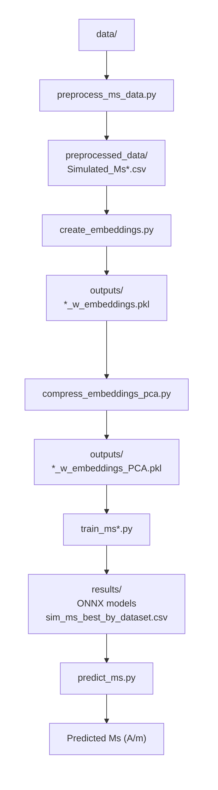

# compound-to-simulated-ms

Predict the **simulated (DFT) saturation magnetisation Ms** (in A/m) of a magnetic compound
directly from its chemical formula, via a matscholar200 compound embedding.

This is a sibling of `compound-to-simulated-tc` (same pipeline and code structure) but
targets Ms instead of Tc, and is fed by the raw Ms sources used by `my_ms`. The companion
project `compound-to-experimental-ms` is identical but targets the *experimental* Ms.

> **Trained in log-space.** Ms spans ~6 orders of magnitude, so models are trained on
> `log1p(Ms)`; `predict_ms.py` applies `expm1` so predictions come back in physical A/m.

> **What the target actually is (important).** The source databases report the *collinear /
> fully-aligned* (DFT) magnetic moment per cell. For **ferromagnets** this equals the
> physical saturation magnetisation, so metals/intermetallics predict well (~±10–20%). For
> **ferrimagnets** (spinel ferrites, garnets like YIG, magnetite Fe₃O₄) it is the
> *uncompensated* moment — the antiparallel sublattices are **not** cancelled — so the
> training Ms, and hence the model, is several-fold **larger** than the true net Ms
> (e.g. Fe₃O₄ training ≈ 1.7×10⁶ vs physical ≈ 4.8×10⁵ A/m). Read predictions for
> ferrimagnetic oxides as the collinear moment, not the net saturation magnetisation.
> (Deduplication uses the pymatgen *reduced formula*, so spellings like CoFe₂O₄ / Fe₂CoO₄
> are pooled.) See `first_model_analysis.txt` and `further_improvements.txt`.
>
> **You can verify this yourself.** `data/validation_ferrimagnetic_compounds_reference.csv` lists 13 known
> ferrimagnets with their *measured net* Ms. Run
> `python src/validate_reference_data.py --ref data/validation_ferrimagnetic_compounds_reference.csv`
> and the deployed MLP over-predicts every one — median |rel.err| ≈ +187 %, e.g. Fe₃O₄ +133 %,
> YIG (Y₃Fe₅O₁₂) +252 %, up to +4777 % for Gd₃Fe₅O₁₂ (near its compensation point) — confirming
> that the learned quantity is the collinear moment, not the net Ms. (Over the broader
> 21-compound `validation_reference.csv`, which mixes these ferrimagnets with true ferromagnets,
> the median |rel.err| is 62 %.)

## Pipeline overview

```
data/<raw sources>                         (per-project copies of the raw Ms source files)
  └─ src/preprocess_ms_data.py   ──► preprocessed_data/Simulated_Ms{,_all,_RE,_RE-Free}.csv
       └─ src/create_embeddings.py        ──► outputs/*_w_embeddings.pkl        (200-D)
            └─ src/compress_embeddings_pca.py ──► outputs/*_w_embeddings_PCA.pkl (+PCA 8/16/32/64)
                 └─ src/train_ms.py (+ _all/_re/_re_free) ──► results/onnx_models/*.onnx,
                                                              results/sim_ms_best_by_dataset.csv
                      └─ src/predict_ms.py   ──► Ms (A/m) for any formula
```


## 0. Installation

Python ≥ 3.12. Create a venv and install `requirements.txt`:
```bash
python3 -m venv .venv && source .venv/bin/activate
pip install -r requirements.txt
```
(The SLURM scripts `source .venv/bin/activate`; adjust if your environment differs.)

## 1. Pre-process the raw data

`src/preprocess_ms_data.py` reads the raw **simulated** Ms sources from `data/`, converts
each to A/m, pools all values per composition into a **single median** (no mean, no
median-of-medians), flags rare-earth membership (pymatgen), drops unparsable formulae,
**drops low-Ms compounds** (`--ms-threshold`, default 50000 A/m, as in `my_ms`), and by
default **drops known ferrimagnets** (see below).

```bash
python src/preprocess_ms_data.py                    # default: drop known ferrimagnets, --ms-threshold 50000
python src/preprocess_ms_data.py --include-ferrimagnets   # keep known ferrimagnets
python src/preprocess_ms_data.py --ms-threshold 0   # keep all Ms magnitudes
```

**`--include-ferrimagnets`** (default: off → ferrimagnets dropped). For ferrimagnets the
training Ms is the *collinear / uncompensated* moment, not the net saturation magnetisation
(see the "What the target actually is" note above), so by default the script removes the
compounds it can confidently identify as ferrimagnetic — magnetite (Fe₃O₄), classic spinel
ferrites (MFe₂O₄), iron garnets (R₃Fe₅O₁₂) and hexaferrites (MFe₁₂O₁₉) — a **curated,
high-confidence subset** (**27** compounds in the current data: 18 only in
`MP_energy_filtered.csv` — the iron-garnet and hexaferrite families — 7 only in
`oqmd_stable.csv` — the classic spinel ferrites — and 2 in both, Fe₃O₄ and SrFe₁₂O₁₉).
The script prints a warning either way:
- default → `CAREFUL: the dataset MAY STILL CONTAIN UNKNOWN ferrimagnets` (composition cannot
  identify ferrimagnetism in general);
- with the flag → `CAREFUL: N KNOWN ferrimagnets ARE INCLUDED`.

> The simulated set has a large near-zero / non-magnetic population (many entries with
> Ms = 0). The default 50000 A/m threshold removes it; lower/disable via `--ms-threshold`.

Raw sources (in `data/`) and their conversion to A/m:

| source | sep | composition col | value col | → A/m |
|---|---|---|---|---|
| `oqmd_stable.csv` | `,` | `composition` | `Ms` (Tesla) | `/ µ0` |
| `Bhandari_XII_sim.csv` | `;` | `material` | `Ms (A/m)` | (already A/m) |
| `MP_energy_filtered.csv` | `,` | `formula_pretty` | `total_magnetization_normalized_vol` (ground-state row) | `× µ_B/ų` |

`MP_energy_filtered.csv` replaces the former `mp_fm_dedup_sim_data.csv`. It lists several FM
polymorphs per compound at different formation energies (with each compound's minimum in
`compound_min_formation_energy_per_atom`); the loader keeps only each compound's **ground-state**
row(s) — those at the minimum formation energy — before the per-composition median pooling.

Outputs (`preprocessed_data/`): `Simulated_Ms.csv` (composition, Ms, contains_re),
`Simulated_Ms_all.csv`, `Simulated_Ms_RE.csv`, `Simulated_Ms_RE-Free.csv`.

## 2–3. Embeddings + PCA

```bash
python src/create_embeddings.py        # → outputs/*_w_embeddings.pkl (200-D matscholar200)
python src/compress_embeddings_pca.py  # → adds comp_emb_pca_8/16/32/64
```

## 4. Train

**NEEDS** (from steps 1–3): the preprocessed CSVs (`preprocessed_data/*.csv`) and the PCA
embeddings (`outputs/*_w_embeddings_PCA.pkl`). Run steps 1–3 first.

```bash
python src/train_ms.py            # all three datasets (RE-Free, RE, All)
# or one at a time (SLURM-friendly):
python src/train_ms_all.py
python src/train_ms_re.py
python src/train_ms_re_free.py
```

Which model families run is set in **`training_config.yaml`** (currently **RF + MLP + LightGBM**,
`re_features: true`). Training is in `log1p(Ms)` space; metrics/plots are reported in log1p
units. Outputs: `results/onnx_models/<Dataset>_<emb>_<model>[_refeats]_e<N>.onnx`,
per-dataset `*_results[_agg].csv`, and `results/sim_ms_best_by_dataset.csv`.

### Configuration (`training_config.yaml`)
- `re_features: true` — append 7 rare-earth physics features → 207-D input; ONNX gets a
  `_refeats` suffix. **All embeddings are exportable** (`raw_200D` and every PCA variant): for
  the PCA variants the embedding-only PCA and the RE-feature pass-through are folded into a
  single in-graph PCA (`_pca_passthrough`), so the deployed graph consumes the raw
  `[embedding | 7 feats]` vector and `predict_ms` feeds it unchanged.
- `models:` — per-family `enabled` / `ensemble`. **Random Forest, MLP and LightGBM are enabled**
  (10-member ensembles each); **Linear is disabled** (far behind on Ms). MLP is the strongest
  family on all three datasets (see Results).

## 5. Predict

`src/predict_ms.py` predicts Ms (A/m) for any formula using the exported ONNX models — it
does all preprocessing internally (embedding, PCA/scaler baked into the graph, RE features,
and `expm1` back to A/m).

**NEEDS**: the ONNX models from step 4 (`results/onnx_models/*.onnx`) — run training first;
`python src/predict_ms.py --list` shows what's available.

```bash
python src/predict_ms.py --compound Nd2Fe14B --best      # best model for the compound type
python src/predict_ms.py --compound Fe --all             # all applicable models, mean ± std
python src/predict_ms.py --compounds-file new_materials.txt --best
python src/predict_ms.py --list
python src/predict_ms.py --compound Fe --best --no-disclaimer   # suppress the disclaimer
```

> **Are these compounds actually new?** `python -m src.check_new_materials` cross-checks every
> formula in `new_materials.txt` against the raw sources, the training set, and the validation
> references (matched by reduced formula) and writes `new_materials_known.txt`. For the shipped
> list all 8 are already present in the data — so predicting them is in-sample, not a
> generalisation test.

**Reliability disclaimer.** By default `predict_ms.py` prints a disclaimer to **stderr**
before predicting (except for `--list`), warning that the learned target is the DFT
collinear moment — correct for ferromagnets but an over-estimate for ferri-/antiferromagnets
(ferrites, garnets, oxides), so predictions must be checked and used with care. It goes to
stderr, so it never pollutes the machine-readable table on stdout. Pass **`--no-disclaimer`**
to suppress it (e.g. for scripted/batch use).

`--best`/`--all` auto-detect rare-earth content and pick the right dataset's model(s). The
RE and RE-Free models do not extrapolate across the RE boundary, so `predict_ms` **refuses**
a mismatched `--model` (use an `All_*` model, which is valid for both).

## 6. Results

All models were trained with the default option, where known ferrimagnets are dropped and the
Ms threshold is 50000 A/m.

**Dataset sizes** (ground-state `MP_energy_filtered.csv` + `oqmd_stable.csv` +
`Bhandari_XII_sim.csv`, after per-composition median pooling, the 50000 A/m cut and dropping 27
known ferrimagnets): **All 56,628**, **RE 19,929**, **RE-Free 36,699** compositions; Ms range
5.0×10⁴ – 2.1×10⁶ A/m (median 2.5×10⁵). All three datasets (RE, RE-Free, All) were (re)trained
together on this data with the current config **{RF, MLP, LightGBM}**, 10-member ensembles,
`re_features: true`.

### Best model per dataset

Deployed best model per dataset (from `results/sim_ms_best_by_dataset.csv`, ensemble mean ± std
over N = 10 splits):

| Dataset | Embedding | Model | N  | R²    | R² std | MAE   | MAE std | RMSE  | RMSE std | MAE_Am    | MedRelErr |
| ------- | --------- | ----- | -- | ----- | ------ | ----- | ------- | ----- | -------- | --------- | --------- |
| RE      | raw_200D  | LGBM  | 10 | 0.760 | 0.008  | 0.283 | 0.005   | 0.392 | 0.008    | 70575.461 | 0.196     |
| RE-Free | raw_200D  | LGBM  | 10 | 0.757 | 0.004  | 0.288 | 0.002   | 0.391 | 0.004    | 76169.297 | 0.206     |
| All     | raw_200D  | LGBM  | 10 | 0.745 | 0.004  | 0.299 | 0.002   | 0.402 | 0.003    | 77125.724 | 0.215     |

> **MLP is the strongest family on every dataset** and is the deployed best, ONNX-exported
> directly (`raw_200D` MLP for All, `pca_64` MLP for RE and RE-Free) — for the PCA variants the
> projection is folded into the graph (see `_pca_passthrough`). `raw_200D` MLP is statistically
> identical to `pca_64` (RE-Free 0.805 vs 0.806; RE 0.764 vs 0.765), so either is a fine deploy
> target. Every embedding × family is exported: **450 ONNX files** = 3 datasets × 5 embeddings
> (`raw_200D`, `pca_8/16/32/64`) × 3 families (MLP/LightGBM/RF) × 10 ensemble members. So
> `predict_ms.py --best` resolves to the `pca_64` MLP ensemble for RE/RE-Free out of the box,
> and every other model stays reachable via `predict_ms.py --all`.

### Results — All materials

| Dataset | Embedding | Model | N  | R²    | R²_std | MAE   | MAE_std | RMSE  | RMSE_std | MAE_Am     | MedRelErr |
| ------- | --------- | ----- | -- | ----- | ------ | ----- | ------- | ----- | -------- | ---------- | --------- |
| All     | raw_200D  | LGBM  | 10 | 0.745 | 0.004  | 0.299 | 0.002   | 0.402 | 0.003    | 77125.724  | 0.215     |
| All     | pca_64    | LGBM  | 10 | 0.714 | 0.005  | 0.322 | 0.003   | 0.426 | 0.004    | 85316.189  | 0.239     |
| All     | pca_32    | LGBM  | 10 | 0.712 | 0.005  | 0.325 | 0.003   | 0.427 | 0.003    | 85756.694  | 0.241     |
| All     | raw_200D  | RF    | 10 | 0.710 | 0.004  | 0.321 | 0.003   | 0.429 | 0.004    | 83450.649  | 0.233     |
| All     | pca_16    | LGBM  | 10 | 0.690 | 0.005  | 0.339 | 0.003   | 0.444 | 0.003    | 89521.586  | 0.253     |
| All     | pca_32    | RF    | 10 | 0.683 | 0.004  | 0.345 | 0.003   | 0.448 | 0.003    | 93009.845  | 0.258     |
| All     | pca_16    | RF    | 10 | 0.678 | 0.003  | 0.347 | 0.002   | 0.452 | 0.003    | 93411.367  | 0.260     |
| All     | pca_64    | RF    | 10 | 0.665 | 0.005  | 0.352 | 0.003   | 0.461 | 0.004    | 93727.723  | 0.262     |
| All     | pca_8     | RF    | 10 | 0.601 | 0.005  | 0.386 | 0.002   | 0.503 | 0.003    | 104957.277 | 0.288     |
| All     | pca_8     | LGBM  | 10 | 0.560 | 0.006  | 0.416 | 0.002   | 0.529 | 0.004    | 113919.810 | 0.323     |

### Results — RE materials

| Dataset | Embedding | Model | N  | R²    | R²_std | MAE   | MAE_std | RMSE  | RMSE_std | MAE_Am     | MedRelErr |
| ------- | --------- | ----- | -- | ----- | ------ | ----- | ------- | ----- | -------- | ---------- | --------- |
| RE      | raw_200D  | LGBM  | 10 | 0.760 | 0.008  | 0.283 | 0.005   | 0.392 | 0.008    | 70575.461  | 0.196     |
| RE      | pca_64    | LGBM  | 10 | 0.734 | 0.008  | 0.303 | 0.005   | 0.412 | 0.007    | 76412.566  | 0.216     |
| RE      | pca_32    | LGBM  | 10 | 0.724 | 0.007  | 0.313 | 0.005   | 0.420 | 0.006    | 78768.175  | 0.229     |
| RE      | raw_200D  | RF    | 10 | 0.700 | 0.008  | 0.328 | 0.005   | 0.438 | 0.008    | 82088.333  | 0.241     |
| RE      | pca_16    | LGBM  | 10 | 0.682 | 0.006  | 0.343 | 0.005   | 0.451 | 0.006    | 86048.682  | 0.257     |
| RE      | pca_32    | RF    | 10 | 0.670 | 0.008  | 0.355 | 0.005   | 0.459 | 0.007    | 90263.846  | 0.270     |
| RE      | pca_16    | RF    | 10 | 0.662 | 0.007  | 0.358 | 0.005   | 0.465 | 0.006    | 90111.545  | 0.271     |
| RE      | pca_64    | RF    | 10 | 0.661 | 0.010  | 0.354 | 0.006   | 0.465 | 0.007    | 89345.856  | 0.263     |
| RE      | pca_8     | RF    | 10 | 0.574 | 0.008  | 0.400 | 0.005   | 0.522 | 0.006    | 102600.148 | 0.298     |
| RE      | pca_8     | LGBM  | 10 | 0.572 | 0.008  | 0.406 | 0.005   | 0.523 | 0.007    | 104517.387 | 0.308     |


### Results — RE-Free materials

| Dataset | Embedding | Model | N  | R²    | R²_std | MAE   | MAE_std | RMSE  | RMSE_std | MAE_Am     | MedRelErr |
| ------- | --------- | ----- | -- | ----- | ------ | ----- | ------- | ----- | -------- | ---------- | --------- |
| RE-Free | raw_200D  | LGBM  | 10 | 0.757 | 0.004  | 0.288 | 0.002   | 0.391 | 0.004    | 76169.297  | 0.206     |
| RE-Free | raw_200D  | RF    | 10 | 0.728 | 0.004  | 0.309 | 0.003   | 0.413 | 0.004    | 82883.156  | 0.223     |
| RE-Free | pca_32    | LGBM  | 10 | 0.725 | 0.004  | 0.314 | 0.003   | 0.415 | 0.004    | 84927.724  | 0.231     |
| RE-Free | pca_64    | LGBM  | 10 | 0.725 | 0.003  | 0.313 | 0.003   | 0.416 | 0.003    | 84795.419  | 0.231     |
| RE-Free | pca_16    | LGBM  | 10 | 0.698 | 0.005  | 0.331 | 0.003   | 0.435 | 0.004    | 89466.635  | 0.246     |
| RE-Free | pca_32    | RF    | 10 | 0.688 | 0.004  | 0.341 | 0.003   | 0.443 | 0.004    | 95098.245  | 0.254     |
| RE-Free | pca_16    | RF    | 10 | 0.679 | 0.005  | 0.346 | 0.004   | 0.449 | 0.005    | 95884.292  | 0.258     |
| RE-Free | pca_64    | RF    | 10 | 0.676 | 0.004  | 0.346 | 0.003   | 0.451 | 0.004    | 95417.842  | 0.258     |
| RE-Free | pca_8     | RF    | 10 | 0.593 | 0.007  | 0.389 | 0.005   | 0.506 | 0.006    | 108853.946 | 0.291     |
| RE-Free | pca_8     | LGBM  | 10 | 0.584 | 0.007  | 0.398 | 0.004   | 0.511 | 0.006    | 111015.387 | 0.302     |

