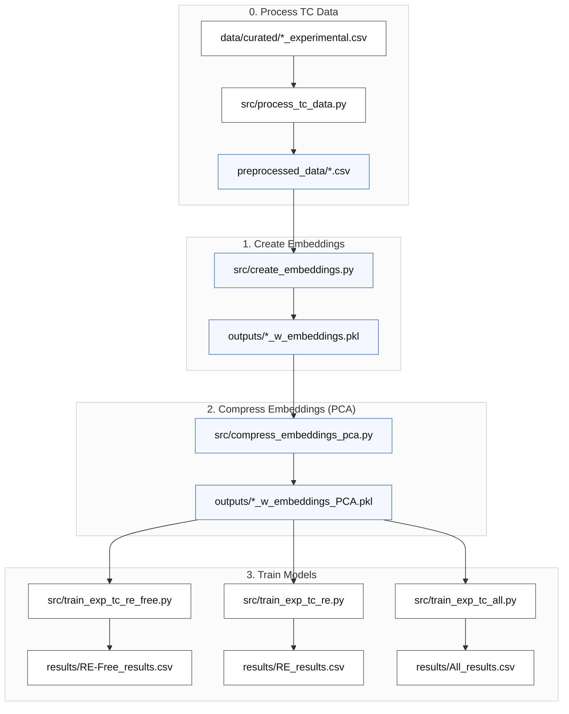

# Predicting experimental Curie temperatures from compound embeddings

This pipeline trains machine learning models that predict experimental Curie temperatures
(Tc_exp, in Kelvin) directly from stoichiometric compound embeddings — without any
simulated Tc values or data augmentation.

## Pipeline overview



Three datasets are trained independently (steps 3a–3c can run in any order or in parallel):
- **RE-Free** — rare-earth-free compounds (5,857 rows — **curated**, see §1)
- **RE** — rare-earth-containing compounds (8,800 rows)
- **All** — combined dataset (14,657 rows)

> **Note:** `src/train_exp_tc.py` is still available as a convenience script that runs all
> three datasets in sequence and is the shared library used by the individual scripts.

## 0. Installation

Install Python dependencies:

```bash
pip install -r requirements.txt
```

PyTorch must be installed separately to match your hardware:

```bash
# CPU-only example — see https://pytorch.org/get-started/locally/ for GPU variants
pip install torch --index-url https://download.pytorch.org/whl/cpu
```

## 1. Pre-Process Data

> **RE-free data curation (with partner UU).** The rare-earth-free (RE-free) Tc data has been
> curated together with partner UU. Each raw-source entry was reviewed and classified as
> *experimental* or *theoretical* (mean-field / Monte-Carlo / RPA / ...); for RE-free compounds
> this expert classification (`Sim-TC-HH-NH-AV.xlsx`) takes **precedence** over the raw-source
> flag, and entries UU flagged as wrong/unusable were dropped. The raw sources were split
> accordingly into experimental/simulated files under `data/curated/`, and this
> (experimental-Tc) project now builds its datasets from the **experiment-only** curated files
> `data/curated/*_experimental.csv` and writes **experimental outputs only**. Because the audit
> found that many values the public databases had labelled "simulated" are in fact
> experimental, the experimental set GREW: RE-free 5,680 -> **5,857** (All 14,480 -> **14,657**);
> the RE set is unchanged (the curation is RE-free only). The original raw-source generator is
> kept at `src/process_tc_data.py.bak`.

1. **Aggregate** the curated experiment-only source files (`data/curated/*_experimental.csv`).  
2. **Clean** Tc values: remove units, symbols, and uncertainties; convert to float.  
3. **Drop** invalid (non-numeric) Tc entries.  
4. **Canonicalise & deduplicate**: reduce each formula to its pymatgen *reduced formula* (so H₂O/H₄O₂, CoFe₂O₄/Fe₂CoO₄ and other spelling / element-ordering / stoichiometric-multiple variants pool together; unparsable strings are dropped), then take the **median Tc** per reduced composition.  
5. **Flag** compositions containing rare-earth elements.  
6. **Split** data into RE-containing and RE-free subsets.  
7. **Save** clean, structured datasets for analysis.


Run:

```bash
python src/process_tc_data.py
```
**Needs:**
```
data/curated/DS1+DS2_experimental.csv
data/curated/MagneticMaterials_All_experimental.csv
data/curated/combinded_tables_experimental.csv
data/curated/literature_values_prepared_experimental.csv
data/curated/m-tcsum_nur_new_experimental.csv
```
**Outputs:**
```
preprocessed_data/Experimental_Tc_all.csv
preprocessed_data/Experimental_Tc.csv            (adds a contains_re column)
preprocessed_data/Experimental_Tc_RE.csv
preprocessed_data/Experimental_Tc_RE-Free.csv
```

## 2. Create compound embeddings

Generates element-abundance-weighted compound embeddings from the Matscholar200
element vectors (200-dimensional). For example:

```
Fe2O3 embedding = (2/5) × [Fe vec] + (3/5) × [O vec]
```

Run:

```bash
python src/create_embeddings.py
```

**Needs:**
```
preprocessed_data/Experimental_Tc_RE-Free.csv
preprocessed_data/Experimental_Tc_RE.csv
preprocessed_data/Experimental_Tc_all.csv
data/embeddings/element/matscholar200.json
```

**Outputs:**
```
outputs/Experimental_Tc_RE-Free_w_embeddings.pkl
outputs/Experimental_Tc_RE_w_embeddings.pkl
outputs/Experimental_Tc_all_w_embeddings.pkl
logs/create_embeddings.txt
```

Each pickle contains the original `composition` and `Tc_exp` columns plus a
`compound_embedding` column holding a 200-D numpy array per row. Rows whose
compositions cannot be parsed or contain elements absent from the Matscholar200
vocabulary are dropped.

## 3. Compress embeddings with PCA

Fits PCA on each dataset independently and adds compressed embedding columns for
component sizes 8, 16, 32, and 64.

Run:

```bash
python src/compress_embeddings_pca.py
```

**Needs:**
```
outputs/Experimental_Tc_RE-Free_w_embeddings.pkl
outputs/Experimental_Tc_RE_w_embeddings.pkl
outputs/Experimental_Tc_all_w_embeddings.pkl
```

**Outputs:**
```
outputs/Experimental_Tc_RE-Free_w_embeddings_PCA.pkl
outputs/Experimental_Tc_RE_w_embeddings_PCA.pkl
outputs/Experimental_Tc_all_w_embeddings_PCA.pkl
logs/compress_embeddings_pca.txt
```

Each output pickle extends the input with columns `comp_emb_pca_8`, `comp_emb_pca_16`,
`comp_emb_pca_32`, and `comp_emb_pca_64`.

## 4. Train models

The framework supports **four model families**, but the shipped `training_config.yaml`
enables only the top-two — **LightGBM and Random Forest** (Linear and MLP are available but
disabled, since they trail badly on Tc). Each (family × embedding) is trained as an
**ensemble** of N members on different random train/test splits (N per family, default 10),
so the shipped default is 2 × 5 × 10 = **100 fits per dataset**.

| Model family | Notes |
|---|---|
| Linear (Lasso / Ridge, best of two) | all 5 embedding variants |
| Random Forest (randomised CV, tuned once per embedding) | all 5 embedding variants |
| MLP with early stopping (PyTorch) | all 5 embedding variants |
| LightGBM (gradient-boosted trees, randomised CV, tuned once per embedding) | all 5 embedding variants |

**Enabled in the shipped config:** LightGBM + Random Forest only (the top-two on Tc). Linear
and MLP remain in the table because they are implemented and can be re-enabled in
`training_config.yaml`.

Embedding variants: `raw_200D`, `pca_8`, `pca_16`, `pca_32`, `pca_64`.

Hyperparameters are scaled to the training-set size:
- **RF / LightGBM `n_iter`** scales inversely with n_train (the search is run **once**
  per (dataset, embedding) and the best params are reused across all ensemble members).
- **MLP architecture**: `(128, 64, 32)` for n_train < 6 000; `(256, 128, 64)` otherwise.

> **ONNX note:** every model — Linear, RF, MLP **and LightGBM** — is exported to ONNX
> (`results/onnx_models/`) for use by `predict_tc.py`. LightGBM export requires the
> `onnxmltools` package (in `requirements.txt`); if it is missing, only LightGBM is
> skipped and training still completes. With `re_features` enabled the ONNX input
> changes from a 200-D embedding to `[embedding | 7 RE feats]` (207-D), and `predict_tc`
> supplies the extra features automatically (see the `re_features` row below).

### Configuration (`training_config.yaml`)

Which families to train, the ensemble size, and the rare-earth feature toggle are all
controlled by `training_config.yaml`:

```yaml
  re_features: true         # shipped default: rare-earth physics features ON (see below)
  models:                   # shipped default enables only the top-two families (LGBM + RF)
    linear:
      enabled: false        # trails badly on Tc -> disabled
      ensemble: 10
    rf:
      enabled: true
      ensemble: 10          # train 10 members on different splits; headline = mean ± std
    mlp:
      enabled: false        # trails badly on Tc -> disabled
      ensemble: 10
    lgbm:                   # LightGBM (gradient-boosted trees)
      enabled: true
      ensemble: 10
```

**Options:**

| Key | Values | Meaning |
|---|---|---|
| `models.<family>.enabled` | `true` / `false` | Train this family or skip it entirely. Families: `linear`, `rf`, `mlp`, `lgbm`. |
| `models.<family>.ensemble` | integer ≥ 1 | Number of ensemble members (different random splits). Reported metrics are the **mean ± std** across members. `ensemble: 1` reproduces a single split (std = 0). |
| `re_features` | `true` / `false` | When `true`, append 7 rare-earth physics features (de Gennes factor, S-state fraction, free-ion moment, …) to the embedding. Zero for RE-free compounds, so safe on every dataset. The exported ONNX then takes a **207-D** input `[embedding \| 7 feats]` (**raw_200D only** — PCA variants are skipped, as they'd need an in-graph ColumnTransformer), written with a **`_refeats`** suffix so it doesn't collide with the embedding-only models; `predict_tc` detects the 207-D input and computes & appends the features from the formula automatically. Code default `false`, but the **shipped config sets it `true`**. |

Shorthands: a family may be given as a bare bool (`rf: true` ⇒ enabled, ensemble 1); an
omitted family defaults to enabled with ensemble 1; if the file is missing, all four
families train with ensemble 1 and `re_features` off. `lgbm` requires the optional
`lightgbm` package (otherwise it is skipped with a note).

Each dataset is trained by a dedicated script. Run them individually:

```bash
python src/train_exp_tc_re_free.py   # RE-Free dataset
python src/train_exp_tc_re.py        # RE dataset
python src/train_exp_tc_all.py       # All (combined) dataset
```

Or run all three in one go (backward-compatible):

```bash
python src/train_exp_tc.py
```

**Needs (per script):**
```
outputs/Experimental_Tc_RE-Free_w_embeddings_PCA.pkl    ← train_exp_tc_re_free.py
outputs/Experimental_Tc_RE_w_embeddings_PCA.pkl         ← train_exp_tc_re.py
outputs/Experimental_Tc_all_w_embeddings_PCA.pkl        ← train_exp_tc_all.py
```

**Outputs (per script):**
```
results/<Dataset>_results.csv             (one row per ensemble member)
results/<Dataset>_results_agg.csv         (ensemble mean ± std per model/embedding)
results/exp_tc_comparison.csv             (aggregated, updated from all datasets run so far)
results/exp_tc_best_by_dataset.csv        (best by mean R², updated from all datasets run so far)
results/figures/<dataset>_<embedding>_<model>.png
results/onnx_models/<dataset>_<embedding>_<model>.onnx   (except LightGBM / re_features runs)
logs/train_exp_tc_re_free.txt  |  train_exp_tc_re.txt  |  train_exp_tc_all.txt
```

## 5. Predict Tc for new compounds

`src/predict_tc.py` predicts Tc for any chemical formula using the exported ONNX models
— you give it a formula and it does all preprocessing (embedding, PCA, scaling, and the
RE features if needed) internally.

```bash
# best model for the compound's type (RE vs RE-free is auto-detected)
python src/predict_tc.py --compound Nd2Fe14B --best

# every applicable model, as a comparison table (ensemble mean ± std)
python src/predict_tc.py --compound Fe --all

# a specific model file
python src/predict_tc.py --compound SmCo5 --model results/onnx_models/RE_raw_200D_lgbm_e0.onnx

# many compounds from a file (one formula per line)
python src/predict_tc.py --compounds-file new_materials.txt --best

# list available models
python src/predict_tc.py --list
```

**Choosing a model:** `--best`/`--all` auto-detect rare-earth content and pick the right
dataset's model(s) — `--best` uses the best **RE** model for a rare-earth compound and the
best **RE-Free** model for a rare-earth-free one. If you pass `--model` yourself, match it
to the chemistry — **RE-Free** or **All** for rare-earth-free compounds (Fe, Co, Ni…),
**RE** or **All** for rare-earth compounds (Nd₂Fe₁₄B, SmCo₅…). The RE and RE-Free models
extrapolate poorly across the RE boundary, so `predict_tc` **refuses** a mismatched
`--model` (a RE model on a RE-free compound, or vice-versa) with an error telling you to
use an `All_*` model; the `All` model is always valid.

**RE-features models:** models trained with `re_features: true` are saved with a
`_refeats` suffix and take a 207-D input. `predict_tc` detects this from the ONNX graph
and computes & appends the 7 features automatically — no extra arguments. `--best`/`--all`
resolve to these `_refeats` files when they are the ones on disk (exact embedding-only
name first, `_refeats` as fallback).


### Validate against a reference set (`src/validate_reference_data.py`)

`src/validate_reference_data.py` scores the models against an external reference list of
compounds with known Curie/Néel temperatures (`data/validation_reference.csv`). For each
compound it predicts Tc with **only the best model for that chemistry** — the best **RE**
model for rare-earth compounds, the best **RE-Free** model otherwise (from
`results/exp_tc_best_by_dataset.csv`) — as the **ensemble mean ± std** over the model's
ONNX members (never a best-of-N pick). It reuses the exact prediction path from
`predict_tc.py`, so it can't drift from the deployed predictor.

```bash
python src/validate_reference_data.py
# or point at a different reference / output file
python src/validate_reference_data.py --ref data/validation_reference.csv --out table.csv
```

It prints a table (`compound | RE? | reference | prediction | std | error | best model`),
writes the same to `results/validation_reference_predictions.csv`, and reports a summary
**MAE computed only over the true ferro/ferrimagnetic Curie temperatures** — antiferromagnets
(Néel T) and non-magnetic entries are shown for sanity but excluded from the error, since
the model only predicts a Curie temperature. See `validation_idea.txt` for the rationale
and how to read the results.

---

## Results

Metrics are on held-out 20 % test splits, reported as the **ensemble mean ± std** over
the N members (default N = 10) — not the single luckiest split. R² higher is better;
MAE and RMSE in Kelvin lower is better.

> **Current run:** all three datasets are from the latest run with **LightGBM** and
> `re_features: true` (rare-earth physics features on), N = 10 members each.

### Best model per dataset (ensemble mean ± std)

| Dataset | Embedding | Model | N  | R²    | R² std | MAE    | MAE std | RMSE    | RMSE std |
| ------- | --------- | ----- | -- | ----- | ------ | ------ | ------- | ------- | -------- |
| RE      | raw_200D  | LGBM  | 10 | 0.930 | 0.010  | 39.962 | 1.826   | 71.167  | 4.919    |
| All     | raw_200D  | LGBM  | 10 | 0.859 | 0.009  | 58.085 | 1.372   | 100.352 | 3.282    |
| RE-Free | raw_200D  | LGBM  | 10 | 0.751 | 0.010  | 78.708 | 2.254   | 131.092 | 5.147    |

LightGBM is now the best-performing model across **all three datasets**, although on RE-Free it is closely matched by Random Forest. RE compounds remain substantially more predictable, achieving an (R^2) of approximately **0.93**, compared with **0.86** for the combined dataset and **0.74** for RE-Free compounds. The **full 200-D embedding** provides the strongest overall performance for LightGBM on all three datasets, indicating that dimensionality reduction generally does not improve predictive accuracy for this model.

### All — All models × embeddings (ensemble mean ± std, with RE features)

Latest run: 4 families, `re_features: true`, N = 10 members. Sorted by R².

| Dataset | Embedding | Model | N  | R²    | R² std | MAE    | MAE std | RMSE    | RMSE std |
| ------- | --------- | ----- | -- | ----- | ------ | ------ | ------- | ------- | -------- |
| All     | raw_200D  | LGBM  | 10 | 0.859 | 0.009  | 58.085 | 1.372   | 100.352 | 3.282    |
| All     | raw_200D  | RF    | 10 | 0.856 | 0.010  | 58.920 | 1.839   | 101.538 | 3.525    |
| All     | pca_64    | LGBM  | 10 | 0.855 | 0.008  | 60.961 | 1.016   | 102.022 | 2.997    |
| All     | pca_32    | LGBM  | 10 | 0.853 | 0.009  | 61.566 | 1.095   | 102.496 | 3.274    |
| All     | pca_32    | RF    | 10 | 0.853 | 0.009  | 60.249 | 1.572   | 102.596 | 3.022    |
| All     | pca_16    | RF    | 10 | 0.851 | 0.009  | 60.349 | 1.613   | 103.280 | 3.083    |
| All     | pca_16    | LGBM  | 10 | 0.847 | 0.010  | 63.461 | 1.476   | 104.558 | 3.389    |
| All     | pca_64    | RF    | 10 | 0.845 | 0.009  | 63.212 | 1.724   | 105.247 | 3.182    |
| All     | pca_8     | RF    | 10 | 0.836 | 0.007  | 64.416 | 1.423   | 108.371 | 2.622    |
| All     | pca_8     | LGBM  | 10 | 0.826 | 0.008  | 68.901 | 1.135   | 111.747 | 2.528    |

---

### RE — All models × embeddings (ensemble mean ± std, with RE features)

Latest run: 4 families, `re_features: true`, N = 10 members. Sorted by R².

| Dataset | Embedding | Model | N  | R²    | R² std | MAE    | MAE std | RMSE   | RMSE std |
| ------- | --------- | ----- | -- | ----- | ------ | ------ | ------- | ------ | -------- |
| RE      | raw_200D  | LGBM  | 10 | 0.930 | 0.010  | 39.962 | 1.826   | 71.167 | 4.919    |
| RE      | pca_64    | LGBM  | 10 | 0.928 | 0.009  | 41.758 | 1.425   | 72.609 | 4.535    |
| RE      | pca_32    | LGBM  | 10 | 0.927 | 0.009  | 42.330 | 1.345   | 72.945 | 4.204    |
| RE      | raw_200D  | RF    | 10 | 0.925 | 0.010  | 43.421 | 1.702   | 74.086 | 4.833    |
| RE      | pca_16    | LGBM  | 10 | 0.923 | 0.010  | 44.166 | 1.428   | 74.750 | 4.474    |
| RE      | pca_32    | RF    | 10 | 0.920 | 0.009  | 45.414 | 1.589   | 76.532 | 4.218    |
| RE      | pca_16    | RF    | 10 | 0.919 | 0.010  | 45.228 | 1.686   | 76.783 | 4.428    |
| RE      | pca_8     | LGBM  | 10 | 0.916 | 0.009  | 45.864 | 1.744   | 78.080 | 4.226    |
| RE      | pca_64    | RF    | 10 | 0.915 | 0.009  | 47.778 | 1.452   | 78.833 | 3.830    |
| RE      | pca_8     | RF    | 10 | 0.913 | 0.009  | 46.796 | 1.461   | 79.416 | 4.091    |

LightGBM tops the RE leaderboard; tree models (LightGBM, RF) dominate, MLP follows, and
Linear is well behind.

---


### RE-Free — All models × embeddings (ensemble mean ± std, with RE features)

Latest run: 4 families, `re_features: true`, N = 10 members. Sorted by R². (RE features
are all-zero for RE-free compounds, so they leave LightGBM/Linear unchanged and only
perturb RF/MLP within noise.)

| Dataset | Embedding | Model | N  | R²    | R² std | MAE    | MAE std | RMSE    | RMSE std |
| ------- | --------- | ----- | -- | ----- | ------ | ------ | ------- | ------- | -------- |
| RE-Free | raw_200D  | LGBM  | 10 | 0.751 | 0.010  | 78.708 | 2.254   | 131.092 | 5.147    |
| RE-Free | raw_200D  | RF    | 10 | 0.745 | 0.008  | 80.645 | 1.773   | 132.528 | 4.119    |
| RE-Free | pca_64    | LGBM  | 10 | 0.738 | 0.012  | 81.921 | 2.267   | 134.508 | 5.412    |
| RE-Free | pca_32    | RF    | 10 | 0.734 | 0.010  | 83.344 | 1.612   | 135.357 | 4.116    |
| RE-Free | pca_32    | LGBM  | 10 | 0.734 | 0.009  | 82.937 | 1.854   | 135.404 | 4.194    |
| RE-Free | pca_16    | RF    | 10 | 0.727 | 0.010  | 84.274 | 2.046   | 137.080 | 4.230    |
| RE-Free | pca_64    | RF    | 10 | 0.726 | 0.013  | 85.373 | 1.624   | 137.325 | 4.632    |
| RE-Free | pca_16    | LGBM  | 10 | 0.724 | 0.011  | 85.177 | 2.069   | 137.965 | 4.858    |
| RE-Free | pca_8     | RF    | 10 | 0.705 | 0.012  | 89.472 | 2.893   | 142.612 | 4.585    |
| RE-Free | pca_8     | LGBM  | 10 | 0.693 | 0.014  | 92.806 | 2.540   | 145.477 | 4.698    |

On the RE-Free dataset, LightGBM and Random Forest achieve the strongest performance, with comparable R² values of approximately 0.74. Overall, RE-Free is a more challenging prediction task than RE, resulting in consistently lower performance across all evaluated models.

---