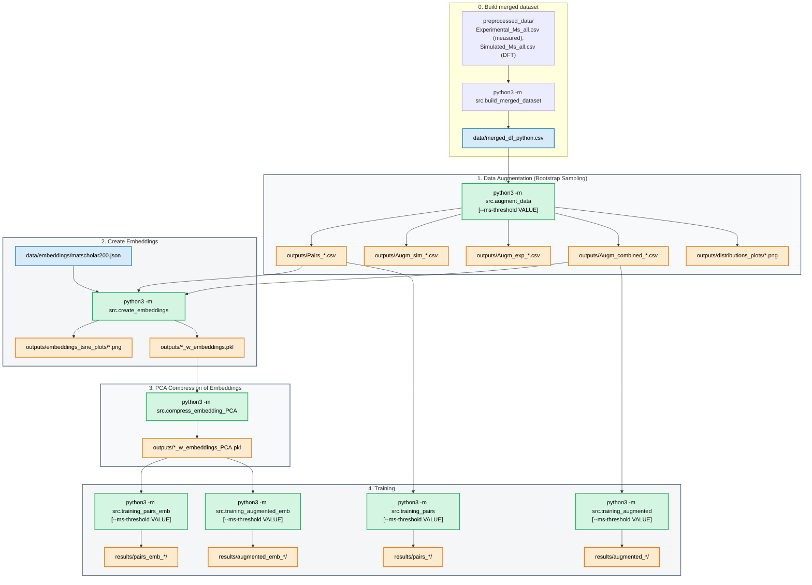

# ML model for systematic errors between simulations and experimental measurements of the Spontaneous Magnetization

Machine-learning pipeline for correcting DFT-simulated saturation magnetisation (Ms)
values against experimental measurements. Models learn the systematic error between
simulated Ms (A/m) and experimental Ms (A/m) and predict a corrected value.

## Current version of model
v0.2

> **Data status (2026-11-09): rebuilt on genuine experimental data.**
> Earlier versions used Materials Project entries flagged "not theoretical" as the
> *experimental* side. That flag means "known to exist experimentally", not "measured
> Ms" — those values are DFT, so most of the old 4,225 "pairs" compared DFT with DFT
> and the reported R² (≈0.8–0.9) was inflated (see `ISSUES.md`).
> The experimental side now contains **measured Ms only** (literature values,
> Bhandari I/XIII, NEMAD; Materials Project excluded); the simulated side is DFT
> (OQMD, Bhandari XII, energy-filtered Materials Project). This leaves
> **473 genuine experiment–simulation pairs (206 RE / 267 RE-free)**, and honest
> cross-validated R² of ≈0.3–0.55. All results below are from this dataset
> (SLURM job 32148042, `run_1node-RE-delta.sh`).

## 0. Installation
Use requirements.txt. In addition pytorch, compatible with your system, must be installed.
- https://pytorch.org/

## Pipeline Overview

The pipeline runs in the stages below. **Stage 0 must be run first if
`data/merged_df_python.csv` does not already exist** — it builds that merged table from
the preprocessed experimental and simulated Ms tables; every later stage depends on it.



| Stage | Script | Description |
|---|---|---|
| 0 | `src/build_merged_dataset.py` | Build `data/merged_df_python.csv` from `preprocessed_data/` (reduced-formula median join; **run first if it does not exist**) |
| 1 | `src/augment_data.py` | Bootstrap augmentation to generate mock Ms_exp / Ms_sim for unpaired rows |
| 2 | `src/create_embeddings.py` | Create 200-D Matscholar compound embeddings |
| 3 | `src/compress_embedding_PCA.py` | Compress embeddings to 8/16/32/64 PCA components |
| 4a | `src/training_pairs.py` | Train on real pairs only, no embeddings |
| 4b | `src/training_augmented.py` | Train on augmented data, no embeddings |
| 4c | `src/training_pairs_emb.py` | Train on real pairs with compound embeddings |
| 4d | `src/training_augmented_emb.py` | Train on augmented data with compound embeddings |

Models trained: Symbolic Regression (PySR), Linear (LASSO / Ridge / OLS), Random Forest, LightGBM, FCNN/MLP.

Datasets: All pairs (473), RE-only (rare-earth compounds, 206), RE-free (not containing RE elements, 267).

All models operate in log1p-space, and R²/RMSE/MAE are reported in `log1p(Ms_exp)` space.

## 1. Data Augmentation

Run:

```
src/augment_data.py
```

The pipeline reads a single merged table:

```
data/merged_df_python.csv
```

Columns: `composition`, `Ms (ampere/meter)_e` (experimental), `Ms (ampere/meter)_s`
(simulated), `material_id`, `has_rare_earth`.

If this file does not exist yet, build it first:

```
python3 -m src.build_merged_dataset
```

This reads the two preprocessed per-compound tables in `preprocessed_data/`:

| File | Content | Sources |
|---|---|---|
| `Experimental_Ms_all.csv` | measured Ms (4,464 compounds) | literature values, Bhandari I/XIII, NEMAD — **Materials Project excluded** |
| `Simulated_Ms_all.csv` | DFT Ms (56,628 compounds) | OQMD, Bhandari XII, energy-filtered Materials Project |

Both sides are re-keyed to the pymatgen reduced formula, duplicates are reduced with a
single median, and the tables are outer-merged: 60,619 compounds, of which 473 have
both values (the pairs), 56,155 are simulation-only and 3,991 experiment-only. The raw
provenance files are kept in `data/raw/` but are not read by the pipeline. The step
only needs to be re-run when `preprocessed_data/` changes.

### Statistical checks (written to `logs/augment_data.txt`)

**RE vs RE-free.** A two-sample KS test on the log-space deltas
`log1p(Ms_exp) − log1p(Ms_sim)` of the 473 pairs gives D = 0.189, p = 4.0·10⁻⁴
(RE: mean −0.05, std 1.01, n = 206; RE-free: mean −0.33, std 0.67, n = 267). The two
groups have different error distributions, which justifies separate models.

**Augmentation validation.** The augmented delta distribution is compared with the
original pairs by a subsampled KS test (median p over subsamples of the original size,
which avoids the sample-size artefact of a plain KS test) and the Wasserstein distance:

| Phase | Split | n orig | n augm | KS D | subsample p (median) | Wasserstein (normalised) |
|---|---|---:|---:|---:|---:|---:|
| 1 (sim-only → mock exp) | All | 473 | 56,628 | 0.0063 | 0.884 | 0.0102 (0.0121) |
| | RE | 206 | 19,929 | 0.0071 | 0.932 | 0.0107 (0.0106) |
| | RE-free | 267 | 36,699 | 0.0054 | 0.910 | 0.0075 (0.0113) |
| 3 (combined) | All | 473 | 60,619 | 0.0056 | 0.920 | 0.0089 (0.0106) |
| | RE | 206 | 22,730 | 0.0054 | 0.932 | 0.0095 (0.0094) |
| | RE-free | 267 | 37,889 | 0.0061 | 0.910 | 0.0084 (0.0126) |

H0 (same distribution) is not rejected for any split. Note what this does and does not
show: the bootstrap reproduces the *marginal* delta distribution of the pairs. It does
not show that the composition → delta relationship is preserved — mock values are drawn
independently of composition.

## 2. & 3. Embedding Creation and Compression

```bash
python3 -m src.create_embeddings
python3 -m src.compress_embedding_PCA
```

## 4a-d Model Training

```bash
python3 -m src.training_pairs
python3 -m src.training_pairs_emb
python3 -m src.training_augmented
python3 -m src.training_augmented_emb
```

## Options

### `--ms-threshold VALUE`

Accepted by: `augment_data`, `training_pairs`, `training_augmented`,
`training_pairs_emb`, `training_augmented_emb`.

Drops all rows where `Ms_sim` or `Ms_exp` is at or below `VALUE` (A/m) **before**
any log-space transformation or model training. This removes the low-Ms poor-DFT
regime where simulations are unreliable and which degrades model performance.

| Value | Effect |
|---|---|
| `50000` | Default — matches the filter used in the reference implementation |
| Any positive float | Custom threshold in A/m |
| `0` | Disable filtering entirely (use all data) |

Examples:

```bash
# Default (50,000 A/m threshold)
python3 -m src.training_pairs

# Custom threshold
python3 -m src.training_pairs --ms-threshold 100000

# Disable threshold
python3 -m src.training_pairs --ms-threshold 0
```

The threshold is applied consistently across:
- `DataLoader.load_pairs_data()` and `load_augmented_data()` in `base_trainer.py`
- Pairs, sim-only, and exp-only rows in `augment_data.py`
- PKL-loaded DataFrames in the embedding training scripts

### `--delta-learning`

Accepted by: `training_pairs`, `training_augmented`, `training_pairs_emb`,
`training_augmented_emb`. It is an on/off flag (no value).

When set, models train on the **correction** to the simulation rather than the
experimental value directly:

```
target = log1p(Ms_exp) - log1p(Ms_sim)      # instead of log1p(Ms_exp)
```

The simulation is treated as the baseline and the model only predicts the systematic
deviation from it. Predictions are reconstructed as
`log1p(Ms_sim) + model_output`, and the `log1p(Ms_sim)` baseline is added back
**before** metrics are computed — so reported R²/RMSE/MAE stay in `log1p(Ms_exp)`
space and remain directly comparable to direct-target runs.

Why it helps: `log1p(Ms_exp)` is dominated by `log1p(Ms_sim)` (the simulation is a
good first approximation). Predicting the target directly spends most of the model's
capacity reproducing that trivial identity; subtracting it focuses all capacity on the
element-specific correction — the hard part. This benefits flexible models (MLP,
RandomForest, Symbolic Regression) most, especially on the small, noisy rare-earth
(RE) data. Linear models are mathematically near-invariant to it.

```bash
# Direct target (default)
python3 -m src.training_pairs

# Delta-learning
python3 -m src.training_pairs --delta-learning

# Combine with a threshold
python3 -m src.training_pairs --ms-threshold 50000 --delta-learning
```

Historic measurement, **previous (Materials-Project-contaminated) dataset only**, test
R²: MLP on RE + embeddings 0.74 → 0.82, MLP on All + embeddings 0.83 → 0.89, Symbolic
Regression on RE 0.41 → 0.47 (`report_improvement_steps_for_results.txt`). The
delta-vs-direct ablation has not been repeated on the genuine 473-pair dataset. Note: Symbolic
Regression requires PySR installed in the run environment, otherwise its rows are
silently skipped.

### `--re-features`

Accepted by: `training_pairs`, `training_augmented`, `training_pairs_emb`,
`training_augmented_emb`. On/off flag (no value).

Appends rare-earth 4f **physics features** to `X`, computed per composition from a
RE³⁺ Hund's-rules lookup table (`src/re_features.py`) and aggregated over the formula.
For rare-earth compounds the DFT simulation-vs-experiment gap is dominated by the
localized 4f moment, which standard collinear DFT mistreats; these features give the
models a near-first-principles estimate of that correction. RE-free rows get all-zero
features, so the flag is safe for every split.

The seven features:

| Feature | Physics |
|---|---|
| `re_fraction` | total atomic fraction of RE elements |
| `mu_free` | Σ xᵢ·(g_J·J)ᵢ — free-ion saturation moment (magnitude of the correction) |
| `spin_proj` | Σ xᵢ·(g_J−1)·Jᵢ — spin projection (RKKY coupling sign/strength to 3d) |
| `de_gennes` | Σ xᵢ·(g_J−1)²J(J+1)ᵢ — exchange strength |
| `nf_weighted` | Σ xᵢ·n_fᵢ — mean 4f filling |
| `heavy_fraction` | atomic fraction of heavy-RE (n_f ≥ 7) atoms |
| `s_state_fraction` | atomic fraction of **S-state** RE (Gd³⁺, Eu²⁺; half-filled 4f⁷, L=0) |

`s_state_fraction` isolates the two ions (Gd, Eu²⁺) whose large, isotropic,
crystal-field-unquenched **pure-spin** moment collinear DFT misses most — these need
by far the largest correction (mean Δ: Eu +1.4, Gd +0.8; all other REs ~+0.01–0.07).
Because `mu_sat` and `de_gennes` rank Tb/Dy *above or near* Gd/Eu, no single continuous
feature isolates them linearly; the explicit flag does, which helps the linear and
symbolic-regression models in particular.

**Valence note:** Eu is modelled as Eu²⁺ (4f⁷, ~7 μ_B) and Yb as Yb²⁺ (4f¹⁴,
nonmagnetic), not the default trivalent states. The Eu²⁺ choice is well justified
(Eu is commonly divalent and was the largest residual anomaly); the Yb²⁺ choice is
more uncertain (few samples, genuine mixed valence).

```bash
python3 -m src.training_pairs --re-features                  # add RE features
python3 -m src.training_pairs --re-features --delta-learning # recommended combo
```

Historic measurement, **previous (Materials-Project-contaminated) dataset only** (test
R², RE pairs, no embedding, delta target): RandomForest 0.47 → 0.85, Ridge 0.47 → 0.74.
These numbers do not carry over to the genuine dataset and the with/without ablation
has not been repeated on it. What the current run does show is consistent with the
features carrying most of the usable signal for RE compounds: with `--re-features`,
RandomForest on RE pairs reaches the same R² with and without embeddings (0.532 vs
0.533). The companion diagnostic is `python3 -m src.residual_diagnostic`.

To enable for a full run, the SLURM scripts expose an `RE_FEATURES` variable
(`run_1node-RE-delta.sh` sets it to `--re-features` by default; `run_1node-RE.sh`
leaves it empty). The `s_state_fraction` feature is part of `--re-features` — no
separate flag is needed.

### `--cv N`

Accepted by: `training_pairs`, `training_augmented`, `training_pairs_emb`,
`training_augmented_emb`. `N` = number of folds (≥ 2); `0`/absent = single 80/20 split.

Reports **N-fold cross-validated metrics (mean ± std)** as the headline numbers
instead of a single split. Strongly recommended for the small, noisy **RE** split,
whose single-split R² swings by ±0.02–0.09 between otherwise-identical runs — the
swings that previously masqueraded as improvements/regressions.

Applies to **all five model families**:
- **Linear, RandomForest, LightGBM** — a fresh clone of the tuned model is refit on
  each fold (`cross_val_report`).
- **MLP** — a fresh network is trained per fold; early stopping uses a validation
  split carved from the fold's *training* data, so the held-out fold stays unseen.
- **Symbolic Regression** — a fresh symbolic search runs per fold. **This is slow**
  (N × the full SR cost); the per-fold train is subsampled (`max_train_samples`) as
  in the single-split path.

Single-split is still computed (it drives the prediction plot and, for SR, the
reported equation); CV means become the headline R²/RMSE/MAE and an `*_std` is added.

```bash
python3 -m src.training_pairs --cv 5 --delta-learning --re-features   # recommended
python3 -m src.training_pairs                                          # single split (default)
```

The SLURM scripts expose a `CV` variable (`run_1node-RE-delta.sh` sets `--cv 5`).

### `--scaler {standard,none}`

Accepted by: `training_pairs`, `training_augmented`, `training_pairs_emb`,
`training_augmented_emb`. Default: `standard`.

Controls feature scaling for the scale-sensitive model families:

| Value | Effect |
|---|---|
| `standard` | LASSO, Ridge and linear regression run behind a `StandardScaler`; the MLP standardises its inputs in a first layer. Mean and standard deviation are taken from the training part of each split only (grid search, single split, every CV fold). |
| `none` | Features are passed to these models unscaled. |

Random forest, LightGBM and symbolic regression are never scaled (tree models are
invariant to monotone feature transformations).

Why it matters: the features live on very different scales (`log1p(Ms_sim)` ≈ 11–14.5,
embedding components ≈ 0, rare-earth features 0–16). The L1/L2 penalties of LASSO and
Ridge act on coefficient size, and gradient-based MLP training is sensitive to input
scale and offset, so both benefit from standardised inputs.

```bash
python3 -m src.training_pairs --scaler standard   # default
python3 -m src.training_pairs --scaler none       # unscaled features
```

The SLURM script exposes a `SCALER` variable (`run_1node-RE-delta.sh` sets
`--scaler standard`).

## Outputs

| Path | Contents |
|---|---|
| `outputs/Pairs_*.csv` | Original paired rows (per dataset split) |
| `outputs/Augm_sim_*.csv` | Phase 1 augmented (sim-only → mock exp) |
| `outputs/Augm_exp_*.csv` | Phase 2 augmented (exp-only → mock sim) |
| `outputs/Augm_combined_*.csv` | Phase 3 combined augmented dataset |
| `outputs/*.pkl` | DataFrames with compound embeddings |
| `results/` | Model comparison CSVs and prediction plots |
| `logs/` | Per-stage stdout logs |

`./clean.sh` removes everything a pipeline run generates (`outputs/`, `results/`,
`figures/`, `data/merged_df_python.csv`, `logs/*.txt`) and keeps the inputs and the
SLURM output files; `-n` lists what would be removed, `-y` skips the confirmation.

## Source layout

```
src/
├── build_merged_dataset.py    Stage 0: build data/merged_df_python.csv from raw sources
├── augment_data.py            Bootstrap augmentation
├── create_embeddings.py       Matscholar200 compound embeddings
├── compress_embedding_PCA.py  PCA compression of embeddings
├── composition_data.py        Composition parsing utilities
├── re_features.py             Rare-earth 4f physics features (--re-features)
├── residual_diagnostic.py     Residual diagnostic for the RE correction
├── log_to_file.py             Stdout-to-file logging decorator
├── training_pairs.py          Entry point: pairs, no embeddings
├── training_augmented.py      Entry point: augmented, no embeddings
├── training_pairs_emb.py      Entry point: pairs + embeddings
├── training_augmented_emb.py  Entry point: augmented + embeddings
└── training/
    ├── base_trainer.py        DataLoader, ModelEvaluator, split_data
    ├── fcnn_mlp.py            FCNN/MLP trainer
    ├── linear_models.py       LASSO / Ridge / OLS trainer
    ├── random_forest.py       Random Forest trainer
    ├── lightgbm_trainer.py    LightGBM trainer
    └── symbolic_regression.py PySR trainer
```

## Results

Run configuration: `run_1node-RE-delta.sh` — `--ms-threshold 50000 --delta-learning
--re-features --cv 5 --scaler standard` (SLURM job 32148042, 2026-11-10). All numbers are **5-fold
cross-validated means** in `log1p(Ms_exp)` space (the delta prediction is added back
to `log1p(Ms_sim)` before the metrics are computed). Full tables including the
fold standard deviations are in `results/*_comparison/`.

### Summary

| Split | Pairs, no embedding | Pairs + embedding | Augmented, no embedding | Augmented + embedding |
|---|---|---|---|---|
| All | 0.444 (MLP) | **0.470** (RF, pca_8) | 0.397 (MLP) | 0.401 (LGBM, pca_8) |
| RE | 0.532 (RF) | **0.533** (RF, pca_8) | 0.295 (LGBM) | 0.303 (LGBM, pca_8) |
| RE-free | 0.307 (Ridge) | **0.347** (Ridge, pca_16) | 0.549 (MLP) | 0.549 (LGBM, pca_16) |

- **The correction is much harder than the previous numbers suggested.** With genuine
  measured data the best pairs models explain about half of the variance for RE
  compounds and about a third for RE-free compounds; the old R² of 0.77–0.90 was an
  artefact of DFT-vs-DFT pairs.
- **Tree ensembles lead on pairs** (RandomForest for RE and All, with fold std ≈ 0.05).
  Embeddings help the tree models on the All split (LightGBM 0.38 → 0.46, RandomForest
  0.36 → 0.47) and RE-free slightly, and add nothing for RE once the RE physics
  features are present.
- **Symbolic regression is weak on 473 pairs** (PySR: 0.14 All, 0.01 RE with a fold
  standard deviation of 0.24; 0.31 RE-free, where it finds a linear law in
  `log1p(Ms_sim)`). PySR is not seeded, so its result varies between runs (RE: 0.09 in
  the previous run).
- **The MLP is competitive without embeddings and unstable with them.** With
  standardised inputs it reaches 0.44 (All), 0.42 (RE) and 0.28 (RE-free) without
  embeddings; with the 64-D and 200-D embeddings it overfits (0.05–0.24).
- **Effect of `--scaler standard`** (compared with the unscaled run, job 32130174,
  archived in `results-job32130174-noscaler/`): RandomForest and LightGBM are
  bit-identical. The MLP without embeddings improves strongly (All 0.20 → 0.44,
  RE 0.26 → 0.42, RE-free 0.21 → 0.28). The linear models are unchanged without
  embeddings and with the 8-/16-D PCA embeddings (within ±0.02), and lose 0.03–0.08
  with the 32-/64-/200-D embeddings, where standardisation inflates low-variance
  embedding components to unit variance. The best model per split is unchanged
  (RE-free Ridge pca_16: 0.355 → 0.347).
- **Pairs and augmented R² are not directly comparable.** Augmented models are
  cross-validated on the augmented set, where about 99 % of the targets are bootstrap
  mock values drawn independently of composition. On that set all model families
  converge to nearly the same R² (e.g. RE-free 0.52–0.55, RE 0.28–0.30).
- **Augmentation does not help on measured data.** In a leakage-free evaluation
  (`python3 deliverable_ms_analysis.py leakfree`: folds over the real pairs only, mock
  rows regenerated per fold from the training pairs, scored on held-out real pairs,
  no embedding) adding the augmented rows lowers R² on every split:

  | Split | Model | Pairs only | + augmentation |
  |---|---|---:|---:|
  | RE | RandomForest | 0.53 | −0.16 |
  | RE | LightGBM | 0.49 | −0.21 |
  | RE-free | OLS | 0.31 | 0.20 |
  | RE-free | LightGBM | 0.28 | 0.19 |
  | All | LightGBM | 0.38 | −0.02 |

  The mock corrections are independent of the compound: the Spearman correlation
  between the correction and `log1p(Ms_sim)` is −0.47 (RE) / −0.35 (RE-free) in the real
  pairs but only −0.10 / −0.02 in the augmented sets. The pairs models are the ones
  to use.

`deliverable_ms_analysis.py` also provides `stats` (distribution statistics) and
`parity` (out-of-fold parity figures of the best pairs models, written to `figures/`).

### Pairs dataset (473 pairs: 206 RE / 267 RE-free)

| Model Family       | Model  | Dataset       | Embedding |        R² |      RMSE |       MAE |
| ------------------ | ------ | ------------- | --------- | --------: | --------: | --------: |
| RandomForest | RF | All-Pairs | pca_8 | **0.470** | **0.590** | **0.447** |
| RandomForest | RF | All-Pairs | pca_16 | 0.460 | 0.595 | 0.452 |
| LightGBM | LGBM | All-Pairs | pca_8 | 0.455 | 0.598 | 0.466 |
| MLP | FCNN | All-Pairs | – | 0.444 | 0.605 | 0.474 |
| RandomForest | RF | All-Pairs | pca_32 | 0.436 | 0.608 | 0.468 |
| LightGBM | LGBM | All-Pairs | pca_16 | 0.434 | 0.610 | 0.476 |
| LightGBM | LGBM | All-Pairs | raw_200D | 0.427 | 0.613 | 0.476 |
| LightGBM | LGBM | All-Pairs | pca_32 | 0.426 | 0.615 | 0.483 |
| MLP | FCNN | All-Pairs | pca_8 | 0.416 | 0.620 | 0.491 |
| RandomForest | RF | All-Pairs | raw_200D | 0.416 | 0.617 | 0.477 |
| RandomForest | RF | All-Pairs | pca_64 | 0.405 | 0.624 | 0.486 |
| LightGBM | LGBM | All-Pairs | pca_64 | 0.385 | 0.636 | 0.503 |
| LightGBM | LGBM | All-Pairs | – | 0.382 | 0.638 | 0.485 |
| MLP | FCNN | All-Pairs | pca_16 | 0.374 | 0.641 | 0.497 |
| RandomForest | RF | All-Pairs | – | 0.359 | 0.648 | 0.494 |
| Linear | LASSO | All-Pairs | pca_8 | 0.344 | 0.657 | 0.531 |
| Linear | LASSO | All-Pairs | pca_16 | 0.334 | 0.662 | 0.538 |
| Linear | LASSO | All-Pairs | pca_32 | 0.314 | 0.671 | 0.544 |
| Linear | LASSO | All-Pairs | raw_200D | 0.309 | 0.674 | 0.544 |
| MLP | FCNN | All-Pairs | pca_32 | 0.298 | 0.677 | 0.518 |
| Linear | LASSO | All-Pairs | – | 0.296 | 0.681 | 0.547 |
| Linear | LASSO | All-Pairs | pca_64 | 0.290 | 0.684 | 0.538 |
| MLP | FCNN | All-Pairs | raw_200D | 0.239 | 0.706 | 0.538 |
| SymbolicRegression | PySR | All-Pairs | – | 0.144 | 0.750 | 0.581 |
| MLP | FCNN | All-Pairs | pca_64 | 0.079 | 0.774 | 0.592 |
| Linear | RIDGE | RE-Free-Pairs | pca_16 | **0.347** | **0.599** | **0.466** |
| Linear | RIDGE | RE-Free-Pairs | pca_8 | 0.323 | 0.610 | 0.472 |
| RandomForest | RF | RE-Free-Pairs | pca_8 | 0.309 | 0.615 | 0.468 |
| LightGBM | LGBM | RE-Free-Pairs | pca_8 | 0.309 | 0.616 | 0.470 |
| Linear | RIDGE | RE-Free-Pairs | – | 0.307 | 0.618 | 0.478 |
| SymbolicRegression | PySR | RE-Free-Pairs | – | 0.307 | 0.618 | 0.479 |
| Linear | LASSO | RE-Free-Pairs | raw_200D | 0.305 | 0.618 | 0.473 |
| RandomForest | RF | RE-Free-Pairs | pca_16 | 0.301 | 0.619 | 0.470 |
| LightGBM | LGBM | RE-Free-Pairs | pca_16 | 0.299 | 0.621 | 0.469 |
| MLP | FCNN | RE-Free-Pairs | pca_16 | 0.298 | 0.621 | 0.478 |
| RandomForest | RF | RE-Free-Pairs | – | 0.295 | 0.625 | 0.476 |
| LightGBM | LGBM | RE-Free-Pairs | raw_200D | 0.292 | 0.622 | 0.477 |
| LightGBM | LGBM | RE-Free-Pairs | pca_32 | 0.290 | 0.624 | 0.469 |
| Linear | LASSO | RE-Free-Pairs | pca_32 | 0.288 | 0.625 | 0.475 |
| MLP | FCNN | RE-Free-Pairs | – | 0.285 | 0.628 | 0.476 |
| Linear | LASSO | RE-Free-Pairs | pca_64 | 0.283 | 0.627 | 0.476 |
| RandomForest | RF | RE-Free-Pairs | raw_200D | 0.282 | 0.626 | 0.473 |
| LightGBM | LGBM | RE-Free-Pairs | pca_64 | 0.280 | 0.626 | 0.480 |
| LightGBM | LGBM | RE-Free-Pairs | – | 0.279 | 0.631 | 0.482 |
| RandomForest | RF | RE-Free-Pairs | pca_32 | 0.278 | 0.628 | 0.476 |
| MLP | FCNN | RE-Free-Pairs | pca_8 | 0.265 | 0.633 | 0.481 |
| RandomForest | RF | RE-Free-Pairs | pca_64 | 0.255 | 0.638 | 0.482 |
| MLP | FCNN | RE-Free-Pairs | raw_200D | 0.230 | 0.649 | 0.495 |
| MLP | FCNN | RE-Free-Pairs | pca_32 | 0.200 | 0.662 | 0.501 |
| MLP | FCNN | RE-Free-Pairs | pca_64 | 0.170 | 0.672 | 0.510 |
| RandomForest | RF | RE-Pairs | pca_8 | **0.533** | **0.592** | **0.445** |
| RandomForest | RF | RE-Pairs | – | 0.532 | 0.594 | 0.446 |
| RandomForest | RF | RE-Pairs | pca_16 | 0.512 | 0.605 | 0.455 |
| LightGBM | LGBM | RE-Pairs | raw_200D | 0.509 | 0.609 | 0.445 |
| RandomForest | RF | RE-Pairs | pca_32 | 0.500 | 0.612 | 0.464 |
| RandomForest | RF | RE-Pairs | raw_200D | 0.495 | 0.618 | 0.478 |
| LightGBM | LGBM | RE-Pairs | – | 0.491 | 0.618 | 0.469 |
| RandomForest | RF | RE-Pairs | pca_64 | 0.491 | 0.618 | 0.471 |
| LightGBM | LGBM | RE-Pairs | pca_32 | 0.486 | 0.622 | 0.462 |
| LightGBM | LGBM | RE-Pairs | pca_8 | 0.473 | 0.627 | 0.462 |
| LightGBM | LGBM | RE-Pairs | pca_16 | 0.459 | 0.639 | 0.473 |
| LightGBM | LGBM | RE-Pairs | pca_64 | 0.453 | 0.639 | 0.485 |
| Linear | LASSO | RE-Pairs | pca_16 | 0.425 | 0.659 | 0.544 |
| MLP | FCNN | RE-Pairs | – | 0.423 | 0.659 | 0.530 |
| Linear | LASSO | RE-Pairs | pca_8 | 0.395 | 0.677 | 0.557 |
| Linear | LASSO | RE-Pairs | pca_64 | 0.381 | 0.685 | 0.562 |
| Linear | LASSO | RE-Pairs | pca_32 | 0.354 | 0.700 | 0.579 |
| Linear | LASSO | RE-Pairs | raw_200D | 0.350 | 0.700 | 0.569 |
| MLP | FCNN | RE-Pairs | pca_8 | 0.336 | 0.703 | 0.551 |
| MLP | FCNN | RE-Pairs | pca_32 | 0.324 | 0.714 | 0.545 |
| MLP | FCNN | RE-Pairs | pca_16 | 0.319 | 0.719 | 0.560 |
| Linear | RIDGE | RE-Pairs | – | 0.312 | 0.721 | 0.595 |
| MLP | FCNN | RE-Pairs | raw_200D | 0.230 | 0.757 | 0.557 |
| MLP | FCNN | RE-Pairs | pca_64 | 0.049 | 0.839 | 0.633 |
| SymbolicRegression | PySR | RE-Pairs | – | 0.011 | 0.859 | 0.650 |

### Augmented dataset (60,619 rows: 22,730 RE / 37,889 RE-free)

Symbolic regression is run without embeddings only.

| Model Family       | Model  | Dataset       | Embedding |        R² |      RMSE |       MAE |
| ------------------ | ------ | ------------- | --------- | --------: | --------: | --------: |
| LightGBM | LGBM | All-Augm | pca_8 | **0.401** | **0.768** | **0.559** |
| LightGBM | LGBM | All-Augm | raw_200D | 0.401 | 0.768 | 0.559 |
| LightGBM | LGBM | All-Augm | pca_16 | 0.400 | 0.768 | 0.559 |
| LightGBM | LGBM | All-Augm | pca_32 | 0.400 | 0.768 | 0.559 |
| LightGBM | LGBM | All-Augm | pca_64 | 0.400 | 0.768 | 0.560 |
| MLP | FCNN | All-Augm | pca_8 | 0.399 | 0.769 | 0.561 |
| MLP | FCNN | All-Augm | pca_16 | 0.397 | 0.770 | 0.565 |
| MLP | FCNN | All-Augm | – | 0.397 | 0.770 | 0.562 |
| LightGBM | LGBM | All-Augm | – | 0.397 | 0.770 | 0.562 |
| RandomForest | RF | All-Augm | pca_8 | 0.395 | 0.771 | 0.563 |
| MLP | FCNN | All-Augm | raw_200D | 0.394 | 0.772 | 0.564 |
| MLP | FCNN | All-Augm | pca_32 | 0.393 | 0.772 | 0.565 |
| RandomForest | RF | All-Augm | pca_16 | 0.393 | 0.773 | 0.565 |
| RandomForest | RF | All-Augm | pca_32 | 0.392 | 0.773 | 0.564 |
| MLP | FCNN | All-Augm | pca_64 | 0.391 | 0.774 | 0.568 |
| RandomForest | RF | All-Augm | – | 0.391 | 0.774 | 0.564 |
| Linear | LASSO | All-Augm | pca_32 | 0.389 | 0.775 | 0.568 |
| Linear | LASSO | All-Augm | raw_200D | 0.389 | 0.775 | 0.568 |
| Linear | LASSO | All-Augm | pca_64 | 0.389 | 0.775 | 0.568 |
| Linear | LASSO | All-Augm | pca_16 | 0.389 | 0.775 | 0.568 |
| Linear | LASSO | All-Augm | pca_8 | 0.388 | 0.776 | 0.569 |
| Linear | LASSO | All-Augm | – | 0.387 | 0.776 | 0.569 |
| RandomForest | RF | All-Augm | pca_64 | 0.387 | 0.776 | 0.566 |
| SymbolicRegression | PySR | All-Augm | – | 0.383 | 0.779 | 0.567 |
| RandomForest | RF | All-Augm | raw_200D | 0.380 | 0.781 | 0.571 |
| LightGBM | LGBM | RE-Free-Augm | pca_16 | **0.549** | **0.580** | **0.428** |
| LightGBM | LGBM | RE-Free-Augm | pca_32 | 0.549 | 0.580 | 0.428 |
| MLP | FCNN | RE-Free-Augm | – | 0.549 | 0.580 | 0.429 |
| LightGBM | LGBM | RE-Free-Augm | pca_8 | 0.549 | 0.581 | 0.428 |
| LightGBM | LGBM | RE-Free-Augm | raw_200D | 0.549 | 0.581 | 0.428 |
| LightGBM | LGBM | RE-Free-Augm | pca_64 | 0.548 | 0.581 | 0.428 |
| LightGBM | LGBM | RE-Free-Augm | – | 0.548 | 0.581 | 0.428 |
| MLP | FCNN | RE-Free-Augm | pca_8 | 0.547 | 0.582 | 0.430 |
| MLP | FCNN | RE-Free-Augm | pca_16 | 0.545 | 0.583 | 0.432 |
| RandomForest | RF | RE-Free-Augm | pca_8 | 0.544 | 0.584 | 0.431 |
| Linear | LASSO | RE-Free-Augm | pca_32 | 0.544 | 0.584 | 0.431 |
| Linear | LASSO | RE-Free-Augm | pca_16 | 0.544 | 0.584 | 0.431 |
| Linear | LASSO | RE-Free-Augm | raw_200D | 0.544 | 0.584 | 0.431 |
| Linear | LASSO | RE-Free-Augm | pca_64 | 0.544 | 0.584 | 0.431 |
| Linear | LASSO | RE-Free-Augm | pca_8 | 0.543 | 0.584 | 0.431 |
| RandomForest | RF | RE-Free-Augm | pca_16 | 0.543 | 0.585 | 0.432 |
| Linear | LINEAR | RE-Free-Augm | – | 0.543 | 0.585 | 0.431 |
| MLP | FCNN | RE-Free-Augm | pca_32 | 0.542 | 0.585 | 0.433 |
| RandomForest | RF | RE-Free-Augm | pca_32 | 0.541 | 0.585 | 0.432 |
| SymbolicRegression | PySR | RE-Free-Augm | – | 0.541 | 0.586 | 0.433 |
| MLP | FCNN | RE-Free-Augm | raw_200D | 0.539 | 0.587 | 0.434 |
| MLP | FCNN | RE-Free-Augm | pca_64 | 0.538 | 0.588 | 0.435 |
| RandomForest | RF | RE-Free-Augm | pca_64 | 0.538 | 0.588 | 0.433 |
| RandomForest | RF | RE-Free-Augm | raw_200D | 0.530 | 0.593 | 0.436 |
| RandomForest | RF | RE-Free-Augm | – | 0.518 | 0.600 | 0.448 |
| LightGBM | LGBM | RE-Augm | pca_8 | **0.303** | **0.901** | **0.697** |
| LightGBM | LGBM | RE-Augm | pca_16 | 0.302 | 0.901 | 0.697 |
| LightGBM | LGBM | RE-Augm | raw_200D | 0.302 | 0.901 | 0.697 |
| LightGBM | LGBM | RE-Augm | pca_32 | 0.301 | 0.902 | 0.698 |
| LightGBM | LGBM | RE-Augm | pca_64 | 0.300 | 0.903 | 0.699 |
| MLP | FCNN | RE-Augm | pca_8 | 0.295 | 0.906 | 0.699 |
| LightGBM | LGBM | RE-Augm | – | 0.295 | 0.906 | 0.704 |
| MLP | FCNN | RE-Augm | – | 0.294 | 0.907 | 0.704 |
| RandomForest | RF | RE-Augm | raw_200D | 0.294 | 0.907 | 0.701 |
| RandomForest | RF | RE-Augm | pca_8 | 0.291 | 0.908 | 0.703 |
| MLP | FCNN | RE-Augm | pca_16 | 0.291 | 0.908 | 0.703 |
| RandomForest | RF | RE-Augm | pca_16 | 0.289 | 0.910 | 0.705 |
| MLP | FCNN | RE-Augm | pca_32 | 0.287 | 0.911 | 0.708 |
| RandomForest | RF | RE-Augm | pca_32 | 0.286 | 0.911 | 0.707 |
| Linear | LASSO | RE-Augm | pca_16 | 0.285 | 0.912 | 0.711 |
| Linear | LASSO | RE-Augm | pca_32 | 0.285 | 0.912 | 0.711 |
| Linear | LASSO | RE-Augm | pca_64 | 0.285 | 0.912 | 0.711 |
| Linear | LASSO | RE-Augm | pca_8 | 0.285 | 0.912 | 0.711 |
| Linear | LASSO | RE-Augm | raw_200D | 0.285 | 0.912 | 0.711 |
| MLP | FCNN | RE-Augm | pca_64 | 0.283 | 0.914 | 0.710 |
| Linear | LASSO | RE-Augm | – | 0.282 | 0.914 | 0.714 |
| RandomForest | RF | RE-Augm | pca_64 | 0.279 | 0.916 | 0.714 |
| RandomForest | RF | RE-Augm | – | 0.278 | 0.916 | 0.712 |
| MLP | FCNN | RE-Augm | raw_200D | 0.278 | 0.917 | 0.711 |
| SymbolicRegression | PySR | RE-Augm | – | 0.278 | 0.917 | 0.714 |

### Best model per dataset

| Dataset | Category | Model Family | Model | Embedding | R² | RMSE | MAE |
| --- | --- | --- | --- | --- | ---: | ---: | ---: |
| **All-Pairs** | Best with embedding | RandomForest | RF | pca_8 | **0.470** | 0.590 | 0.447 |
|  | Best without embedding | MLP | FCNN | – | 0.444 | 0.605 | 0.474 |
|  | Symbolic Regression baseline | SymbolicRegression | PySR | – | 0.144 | 0.750 | 0.581 |
| **RE-Free-Pairs** | Best with embedding | Linear | RIDGE | pca_16 | **0.347** | 0.599 | 0.466 |
|  | Best without embedding | Linear | RIDGE | – | 0.307 | 0.618 | 0.478 |
|  | Symbolic Regression baseline | SymbolicRegression | PySR | – | 0.307 | 0.618 | 0.479 |
| **RE-Pairs** | Best with embedding | RandomForest | RF | pca_8 | **0.533** | 0.592 | 0.445 |
|  | Best without embedding | RandomForest | RF | – | 0.532 | 0.594 | 0.446 |
|  | Symbolic Regression baseline | SymbolicRegression | PySR | – | 0.011 | 0.859 | 0.650 |
| **All-Augm** | Best with embedding | LightGBM | LGBM | pca_8 | **0.401** | 0.768 | 0.559 |
|  | Best without embedding | MLP | FCNN | – | 0.397 | 0.770 | 0.562 |
|  | Symbolic Regression baseline | SymbolicRegression | PySR | – | 0.383 | 0.779 | 0.567 |
| **RE-Free-Augm** | Best with embedding | LightGBM | LGBM | pca_16 | **0.549** | 0.580 | 0.428 |
|  | Best without embedding | MLP | FCNN | – | 0.549 | 0.580 | 0.429 |
|  | Symbolic Regression baseline | SymbolicRegression | PySR | – | 0.541 | 0.586 | 0.433 |
| **RE-Augm** | Best with embedding | LightGBM | LGBM | pca_8 | **0.303** | 0.901 | 0.697 |
|  | Best without embedding | LightGBM | LGBM | – | 0.295 | 0.906 | 0.704 |
|  | Symbolic Regression baseline | SymbolicRegression | PySR | – | 0.278 | 0.917 | 0.714 |
