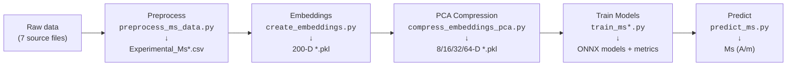

# compound-to-experimental-ms

Predict the **experimental saturation magnetisation Ms** (in A/m) of a magnetic compound
directly from its chemical formula, via a matscholar200 compound embedding.

This is a sibling of `compound-to-experimental-tc` (same pipeline and code structure) but
targets Ms instead of Tc, and is fed by the raw Ms sources used by `my_ms`. The companion
project `compound-to-simulated-ms` is identical but targets the *simulated* (DFT) Ms.

> **Trained in log-space.** Ms spans ~6 orders of magnitude, so models are trained on
> `log1p(Ms)`; `predict_ms.py` applies `expm1` so predictions come back in physical A/m.

> **What the target is (important).** The model is trained on **genuinely measured**
> saturation magnetisation, pooled from literature compilations, the Bhandari tables and the
> NEMAD magnetic-materials database (`Experimental == True` rows only). **Materials Project is
> deliberately excluded**: its `total_magnetization` is a DFT value — the *collinear /
> uncompensated* sublattice moment, not a measurement — which over-estimates ferrimagnets
> several-fold. Because the labels are now real *net* Ms, the model reproduces the physical
> saturation magnetisation, **including for ferrimagnets**: on the held-out reference set it now
> predicts Fe₃O₄ ≈ 0.31 (real ≈ 0.48), YIG ≈ 0.145 (real ≈ 0.14) and MnFe₂O₄ ≈ 0.26 (real ≈ 0.40)
> MA/m — versus the old MP-DFT model's +252 %…+554 % over-predictions. The residual bias is now a
> mild *under*-prediction of the strongest ferromagnets (e.g. pure Fe), a consequence of the
> smaller, noisier genuinely-measured dataset (4,464 compounds vs the old 9,939 MP-DFT ones).
> (Deduplication uses the pymatgen *reduced formula*, so spellings like CoFe₂O₄ / Fe₂CoO₄ are
> pooled.) See `first_model_analysis.txt` and `further_improvements.txt`.

## Pipeline overview

```
data/raw/<sources>                         (literature + Bhandari I/XIII + NEMAD; no Materials Project)
  └─ src/preprocess_ms_data.py   ──► preprocessed_data/Experimental_Ms{,_all,_RE,_RE-Free}.csv
       └─ src/create_embeddings.py        ──► outputs/*_w_embeddings.pkl        (200-D)
            └─ src/compress_embeddings_pca.py ──► outputs/*_w_embeddings_PCA.pkl (+PCA 8/16/32/64)
                 └─ src/train_ms.py (+ _all/_re/_re_free) ──► results/onnx_models/*.onnx,
                                                              results/exp_ms_best_by_dataset.csv
                      └─ src/predict_ms.py   ──► Ms (A/m) for any formula
```



## 0. Installation

Python ≥ 3.12. Create a venv and install `requirements.txt`:
```bash
python3 -m venv .venv && source .venv/bin/activate
pip install -r requirements.txt
```
(On the cluster the SLURM scripts load `python-waterboa/2025.06` + `cuda/13.0` and `source` the
shared `BSW` venv — adjust the `source` line if your environment differs. `clean.sh` wipes all
generated outputs to force a fresh run.)

## 1. Pre-process the raw data

`src/preprocess_ms_data.py` reads the raw **experimental** Ms sources from `data/raw/`, converts
each to A/m, pools all values per composition into a **single median** (no mean, no
median-of-medians), flags rare-earth membership (pymatgen), drops unparsable formulae,
**drops low-Ms compounds** (`--ms-threshold`, default 50000 A/m, as in `my_ms`), and by
default **drops known ferrimagnets** (see below).

```bash
python src/preprocess_ms_data.py                    # default: drop known ferrimagnets, --ms-threshold 50000
python src/preprocess_ms_data.py --include-ferrimagnets   # keep known ferrimagnets
python src/preprocess_ms_data.py --ms-threshold 0   # keep all Ms magnitudes
```

**`--include-ferrimagnets`** (default: off → ferrimagnets dropped). For ferrimagnets the
training Ms is the *collinear / uncompensated* moment, not the net saturation magnetisation
(see the "What the target actually is" note above), so by default the script removes the
compounds it can confidently identify as ferrimagnetic — magnetite (Fe₃O₄), classic spinel
ferrites (MFe₂O₄), iron garnets (R₃Fe₅O₁₂) and hexaferrites (MFe₁₂O₁₉) — a **curated,
high-confidence subset** (~18, to be extended). The script prints a warning either way:
- default → `CAREFUL: the dataset MAY STILL CONTAIN UNKNOWN ferrimagnets` (composition cannot
  identify ferrimagnetism in general);
- with the flag → `CAREFUL: N KNOWN ferrimagnets ARE INCLUDED`.

Raw sources (in `data/raw/`) and their conversion to A/m:

| source | sep | composition col | value col | → A/m |
|---|---|---|---|---|
| `literature_values.csv` | `;` | `Compound` | `mu0Ms (T)` | `/ µ0` |
| `Bhandari_I_exp.csv` | `\|` | `Material` | `Ms_exp (MA/m)` | `× 1e6` |
| `Bhandari_XIII_exp.csv` | `\|` | `Material` | `Ms (MA/m)` | `× 1e6` |
| `Nemad_extracted_Ms.csv` | `,` (`#`-headers) | `composition` | `Ms` | already A/m |

**Materials Project is intentionally NOT a source** — its `total_magnetization` is a DFT value
(the collinear/uncompensated moment), not a measurement, so the `load_mp_exp` loader is kept in
the code for reference but deliberately left out of `EXP_LOADERS`.

Outputs (`preprocessed_data/`): `Experimental_Ms.csv` (composition, Ms, contains_re),
`Experimental_Ms_all.csv`, `Experimental_Ms_RE.csv`, `Experimental_Ms_RE-Free.csv`.

## 2–3. Embeddings + PCA

```bash
python src/create_embeddings.py        # → outputs/*_w_embeddings.pkl (200-D matscholar200)
python src/compress_embeddings_pca.py  # → adds comp_emb_pca_8/16/32/64
```

## 4. Train

**NEEDS** (from steps 1–3): the preprocessed CSVs (`preprocessed_data/*.csv`) and the PCA
embeddings (`outputs/*_w_embeddings_PCA.pkl`). Run steps 1–3 first.

```bash
python src/train_ms.py            # all three datasets (RE-Free, RE, All)
# or one at a time (SLURM-friendly):
python src/train_ms_all.py
python src/train_ms_re.py
python src/train_ms_re_free.py
```

Which model families run is set in **`training_config.yaml`** (currently **all four** — Linear,
Random Forest, LightGBM, MLP — with `re_features: true`). Training is in `log1p(Ms)` space; metrics/plots are reported in log1p
units. Outputs: `results/onnx_models/<Dataset>_<emb>_<model>[_refeats]_e<N>.onnx`,
per-dataset `*_results[_agg].csv`, and `results/exp_ms_best_by_dataset.csv`.

### Configuration (`training_config.yaml`)
- `re_features: true` — append 7 rare-earth physics features → 207-D input; the ONNX file gets a
  `_refeats` suffix. **All embedding variants (raw_200D + PCA 8/16/32/64) are ONNX-exportable**: a
  `_pca_passthrough` helper folds the embedding-only PCA and the feature pass-through into one
  equivalent PCA over the full 207-D input, so PCA + scaler are baked into the graph and the ONNX
  consumes the raw `[embedding | RE features]` vector. `predict_ms` computes & appends the RE
  features automatically.
- `models:` — per-family `enabled` / `ensemble`. All four families are enabled; **RF and LightGBM
  dominate** (they take every per-dataset best), Linear is well behind, and the **MLP is numerically
  unstable** on this small dataset (a few ensemble members produce extreme A/m outliers via
  `expm1`). The deployed best models are therefore all RF or LGBM.

## 5. Predict

`src/predict_ms.py` predicts Ms (A/m) for any formula using the exported ONNX models — it
does all preprocessing internally (embedding, PCA/scaler baked into the graph, RE features,
and `expm1` back to A/m).

**NEEDS**: the ONNX models from step 4 (`results/onnx_models/*.onnx`) — run training first;
`python src/predict_ms.py --list` shows what's available.

```bash
python src/predict_ms.py --compound Nd2Fe14B --best      # best model for the compound type
python src/predict_ms.py --compound Fe --all             # all applicable models, mean ± std
python src/predict_ms.py --compounds-file new_materials.txt --best
python src/predict_ms.py --list
python src/predict_ms.py --compound Fe --best --no-disclaimer   # suppress the disclaimer
```

> **Are these compounds actually new?** `python -m src.check_new_materials` cross-checks every
> formula in `new_materials.txt` against the raw sources, the training set, and the validation
> references (matched by reduced formula) and writes `new_materials_known.txt`. Re-run it after any
> data change — whether the shipped formulas are in-sample or genuinely new depends on the current
> training set.

**Reliability disclaimer.** By default `predict_ms.py` prints a disclaimer to **stderr** before
predicting (except for `--list`); it goes to stderr so it never pollutes the machine-readable table
on stdout. Pass **`--no-disclaimer`** to suppress it (e.g. for scripted/batch use). Note: the
disclaimer text baked into `predict_ms.py` still describes the old MP-DFT behaviour (ferrimagnet
over-prediction) and is **outdated** for this genuinely-measured model — it should be revised.
Predictions remain a model estimate and antiferromagnet/compensated cases should still be sanity-checked.

`--best`/`--all` auto-detect rare-earth content and pick the right dataset's model(s). The
RE and RE-Free models do not extrapolate across the RE boundary, so `predict_ms` **refuses**
a mismatched `--model` (use an `All_*` model, which is valid for both).

## 6. Results

All models trained with the default options (known ferrimagnets dropped, `--ms-threshold 50000`).
Training set after reduced-formula dedup, the threshold and ferrimagnet removal: **4,464 compounds**
(RE 3,007 / RE-free 1,457), from the genuinely-measured sources only — **no Materials Project**.
Metrics are the ensemble mean ± std over ten random 80/20 splits in `log1p(Ms)` space; `MAE_Am` is
the mean absolute error back in A/m and `MedRelErr` the median relative error.

### Best model per dataset

| Dataset | Embedding | Model |  N |    R² | R² Std |   MAE | MAE Std |  RMSE | RMSE Std |    MAE_Am | MedRelErr |
| ------- | --------- | ----- | -: | ----: | -----: | ----: | ------: | ----: | -------: | --------: | --------: |
| RE      | pca_16    | LGBM  | 10 | 0.621 |  0.019 | 0.332 |   0.008 | 0.493 |    0.010 | 162137 |     0.199 |
| All     | pca_16    | RF    | 10 | 0.603 |  0.022 | 0.346 |   0.015 | 0.515 |    0.017 | 158341 |     0.207 |
| RE-Free | raw_200D  | RF    | 10 | 0.552 |  0.042 | 0.375 |   0.024 | 0.536 |    0.028 | 151281 |     0.236 |

> **Compared with the previous (MP-dominated) run** the headline R² is lower (RE 0.89→0.62,
> All 0.81→0.60, RE-free 0.74→0.55): the old numbers were obtained on self-consistent DFT values,
> whereas this model learns genuinely measured — noisier and scarcer — Ms. In exchange it fixes the
> ferrimagnet over-prediction (see the target note at the top: Fe₃O₄ +252%→−36%, YIG +554%→+4%).
> **RF and LGBM take every per-dataset best**; Linear is far behind and the MLP is numerically
> unstable on this small dataset, so the detailed tables below report the robust `MedRelErr` rather
> than `MAE_Am`.

### Results All-Materials

Metrics in `log1p(Ms)` space (the training space); MedRelErr is the median relative error in A/m.

| Dataset | Embedding | Model | N | R² (mean ± std) | MAE (mean ± std) | RMSE (mean ± std) | MedRelErr |
|---|---|---|---:|---|---|---|---|
| All | pca_16 | RF | 10 | 0.603 ± 0.022 | 0.346 ± 0.015 | 0.515 ± 0.017 | 0.207 |
| All | pca_8 | RF | 10 | 0.598 ± 0.027 | 0.354 ± 0.017 | 0.519 ± 0.020 | 0.218 |
| All | raw_200D | RF | 10 | 0.597 ± 0.020 | 0.347 ± 0.014 | 0.519 ± 0.018 | 0.204 |
| All | pca_32 | RF | 10 | 0.596 ± 0.024 | 0.348 ± 0.014 | 0.520 ± 0.017 | 0.204 |
| All | raw_200D | LGBM | 10 | 0.589 ± 0.019 | 0.360 ± 0.014 | 0.525 ± 0.017 | 0.222 |
| All | pca_32 | LGBM | 10 | 0.588 ± 0.023 | 0.359 ± 0.013 | 0.526 ± 0.017 | 0.219 |
| All | pca_16 | LGBM | 10 | 0.585 ± 0.019 | 0.364 ± 0.015 | 0.527 ± 0.017 | 0.227 |
| All | pca_64 | LGBM | 10 | 0.581 ± 0.024 | 0.360 ± 0.015 | 0.529 ± 0.019 | 0.215 |
| All | pca_8 | LGBM | 10 | 0.573 ± 0.021 | 0.374 ± 0.016 | 0.535 ± 0.020 | 0.243 |
| All | pca_64 | RF | 10 | 0.571 ± 0.019 | 0.368 ± 0.017 | 0.536 ± 0.018 | 0.223 |
| All | pca_32 | MLP | 10 | 0.367 ± 0.044 | 0.495 ± 0.024 | 0.651 ± 0.017 | 0.346 |
| All | pca_16 | MLP | 10 | 0.366 ± 0.055 | 0.504 ± 0.023 | 0.651 ± 0.024 | 0.359 |
| All | pca_8 | MLP | 10 | 0.358 ± 0.030 | 0.504 ± 0.017 | 0.656 ± 0.017 | 0.358 |
| All | raw_200D | Linear | 10 | 0.241 ± 0.029 | 0.557 ± 0.019 | 0.713 ± 0.018 | 0.407 |
| All | pca_64 | Linear | 10 | 0.231 ± 0.024 | 0.562 ± 0.018 | 0.718 ± 0.017 | 0.412 |
| All | pca_32 | Linear | 10 | 0.217 ± 0.032 | 0.570 ± 0.020 | 0.724 ± 0.019 | 0.415 |
| All | pca_8 | Linear | 10 | 0.205 ± 0.034 | 0.577 ± 0.021 | 0.730 ± 0.020 | 0.423 |
| All | pca_16 | Linear | 10 | 0.203 ± 0.035 | 0.577 ± 0.020 | 0.731 ± 0.020 | 0.422 |
| All | pca_64 | MLP | 10 | 0.179 ± 0.271 | 0.522 ± 0.029 | 0.734 ± 0.112 | 0.368 |
| All | raw_200D | MLP | 10 | 0.160 ± 0.116 | 0.561 ± 0.022 | 0.748 ± 0.042 | 0.393 |

### Results RE-Materials

Metrics in `log1p(Ms)` space (the training space); MedRelErr is the median relative error in A/m.

| Dataset | Embedding | Model | N | R² (mean ± std) | MAE (mean ± std) | RMSE (mean ± std) | MedRelErr |
|---|---|---|---:|---|---|---|---|
| RE | pca_16 | LGBM | 10 | 0.621 ± 0.019 | 0.332 ± 0.008 | 0.493 ± 0.010 | 0.199 |
| RE | pca_16 | RF | 10 | 0.621 ± 0.022 | 0.329 ± 0.008 | 0.493 ± 0.012 | 0.199 |
| RE | pca_64 | LGBM | 10 | 0.621 ± 0.022 | 0.328 ± 0.011 | 0.493 ± 0.014 | 0.190 |
| RE | pca_8 | RF | 10 | 0.619 ± 0.020 | 0.333 ± 0.009 | 0.494 ± 0.011 | 0.201 |
| RE | pca_32 | LGBM | 10 | 0.617 ± 0.023 | 0.332 ± 0.008 | 0.495 ± 0.013 | 0.193 |
| RE | raw_200D | LGBM | 10 | 0.617 ± 0.027 | 0.324 ± 0.012 | 0.495 ± 0.016 | 0.183 |
| RE | pca_32 | RF | 10 | 0.612 ± 0.025 | 0.331 ± 0.010 | 0.499 ± 0.014 | 0.191 |
| RE | pca_8 | LGBM | 10 | 0.610 ± 0.020 | 0.341 ± 0.008 | 0.500 ± 0.012 | 0.213 |
| RE | raw_200D | RF | 10 | 0.609 ± 0.023 | 0.330 ± 0.009 | 0.500 ± 0.013 | 0.192 |
| RE | pca_64 | RF | 10 | 0.605 ± 0.023 | 0.334 ± 0.009 | 0.503 ± 0.012 | 0.197 |
| RE | pca_16 | MLP | 10 | 0.326 ± 0.071 | 0.497 ± 0.033 | 0.657 ± 0.040 | 0.344 |
| RE | pca_8 | MLP | 10 | 0.311 ± 0.075 | 0.505 ± 0.021 | 0.664 ± 0.032 | 0.355 |
| RE | raw_200D | Linear | 10 | 0.206 ± 0.033 | 0.549 ± 0.013 | 0.714 ± 0.017 | 0.402 |
| RE | pca_64 | Linear | 10 | 0.198 ± 0.038 | 0.552 ± 0.014 | 0.717 ± 0.019 | 0.406 |
| RE | pca_32 | Linear | 10 | 0.191 ± 0.036 | 0.557 ± 0.014 | 0.720 ± 0.018 | 0.406 |
| RE | pca_16 | Linear | 10 | 0.190 ± 0.036 | 0.559 ± 0.014 | 0.720 ± 0.018 | 0.408 |
| RE | pca_8 | Linear | 10 | 0.183 ± 0.035 | 0.562 ± 0.014 | 0.724 ± 0.018 | 0.416 |
| RE | pca_32 | MLP | 10 | 0.171 ± 0.127 | 0.537 ± 0.039 | 0.727 ± 0.058 | 0.364 |
| RE | raw_200D | MLP | 10 | 0.128 ± 0.084 | 0.558 ± 0.035 | 0.747 ± 0.033 | 0.386 |
| RE | pca_64 | MLP | 10 | -0.414 ± 0.607 | 0.576 ± 0.035 | 0.934 ± 0.194 | 0.374 |

### Results RE-Free Materials

Metrics in `log1p(Ms)` space (the training space); MedRelErr is the median relative error in A/m.

| Dataset | Embedding | Model | N | R² (mean ± std) | MAE (mean ± std) | RMSE (mean ± std) | MedRelErr |
|---|---|---|---:|---|---|---|---|
| RE-Free | raw_200D | RF | 10 | 0.552 ± 0.042 | 0.375 ± 0.024 | 0.536 ± 0.028 | 0.236 |
| RE-Free | raw_200D | LGBM | 10 | 0.547 ± 0.047 | 0.373 ± 0.019 | 0.538 ± 0.026 | 0.228 |
| RE-Free | pca_16 | RF | 10 | 0.541 ± 0.044 | 0.375 ± 0.023 | 0.542 ± 0.025 | 0.239 |
| RE-Free | pca_32 | RF | 10 | 0.527 ± 0.042 | 0.388 ± 0.022 | 0.550 ± 0.026 | 0.248 |
| RE-Free | pca_16 | LGBM | 10 | 0.527 ± 0.053 | 0.387 ± 0.024 | 0.550 ± 0.028 | 0.246 |
| RE-Free | pca_8 | RF | 10 | 0.525 ± 0.048 | 0.394 ± 0.023 | 0.551 ± 0.025 | 0.258 |
| RE-Free | pca_64 | RF | 10 | 0.523 ± 0.051 | 0.387 ± 0.025 | 0.552 ± 0.030 | 0.245 |
| RE-Free | pca_32 | LGBM | 10 | 0.519 ± 0.056 | 0.386 ± 0.023 | 0.554 ± 0.029 | 0.236 |
| RE-Free | pca_64 | LGBM | 10 | 0.512 ± 0.061 | 0.389 ± 0.028 | 0.559 ± 0.036 | 0.241 |
| RE-Free | pca_8 | LGBM | 10 | 0.501 ± 0.055 | 0.410 ± 0.022 | 0.565 ± 0.024 | 0.277 |
| RE-Free | raw_200D | Linear | 10 | 0.321 ± 0.058 | 0.515 ± 0.014 | 0.659 ± 0.020 | 0.370 |
| RE-Free | pca_32 | Linear | 10 | 0.316 ± 0.057 | 0.519 ± 0.013 | 0.661 ± 0.020 | 0.378 |
| RE-Free | pca_64 | Linear | 10 | 0.313 ± 0.059 | 0.517 ± 0.013 | 0.663 ± 0.020 | 0.372 |
| RE-Free | pca_16 | Linear | 10 | 0.290 ± 0.056 | 0.527 ± 0.014 | 0.674 ± 0.020 | 0.376 |
| RE-Free | pca_8 | Linear | 10 | 0.282 ± 0.055 | 0.529 ± 0.015 | 0.678 ± 0.019 | 0.385 |
| RE-Free | pca_8 | MLP | 10 | 0.078 ± 0.181 | 0.590 ± 0.050 | 0.765 ± 0.062 | 0.420 |
| RE-Free | pca_16 | MLP | 10 | -0.023 ± 0.137 | 0.621 ± 0.058 | 0.809 ± 0.063 | 0.432 |
| RE-Free | raw_200D | MLP | 10 | -0.309 ± 0.287 | 0.660 ± 0.048 | 0.909 ± 0.080 | 0.443 |
| RE-Free | pca_32 | MLP | 10 | -0.568 ± 0.534 | 0.719 ± 0.075 | 0.997 ± 0.196 | 0.466 |
| RE-Free | pca_64 | MLP | 10 | -12.055 ± 20.528 | 1.410 ± 1.457 | 2.394 ± 1.803 | 0.586 |
